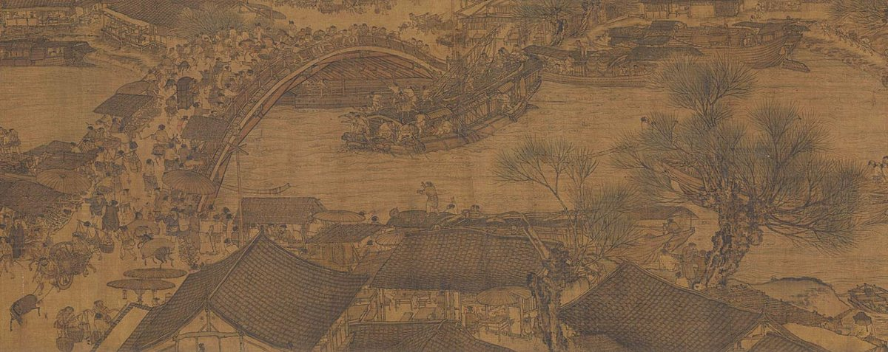

# 张择端清明上河图卷

> 馆藏：故宫博物院 · 北京市·北京市·东城区

> 资料馆文物编号：f619ea6139264560ab4f3d8190f731bc-106

## 基本信息

- **年代**：北宋
- **类别**：书画
- **馆藏单位**：故宫博物院
- **所在地**：北京市·北京市·东城区

## 文物介绍

《清明上河图》卷，北宋，张择端作，绢本，淡设色，纵24.8厘米，横528厘米。 《清明上河图》描绘的是清明时节北宋都城汴京（今河南开封）东角子门内外和汴河两岸的繁华热闹景象。全画可分为三段： 首段写市郊景色，茅檐低伏，阡陌纵横，其间人物往来。 中段以“上土桥”为中心，另画汴河及两岸风光。中间那座规模宏敞、状如飞虹的木结构桥梁，概称“虹桥”，正名“上土桥”，为水陆交通的汇合点。桥上车马来往如梭，商贩密集，行人熙攘。桥下一艘漕船正放倒桅杆欲穿过桥孔，艄工们的紧张工作吸引了许多群众围观。 后段描写的是市区街道，城内商店鳞次栉比，大店门首还扎结着彩楼欢门，小店铺只是一个敞棚。此外还有公廨寺观等。街上行人摩肩接踵，车马轿驼络绎不绝。行人中有绅士、官吏、仆役、贩夫、走卒、车轿夫、作坊工人、说书艺人、理发匠、医生、看相算命者、贵家妇女、行脚僧人、顽皮儿童，甚至还有乞丐。他们的身份不同，衣冠各异，同在街上，而忙闲不一，苦乐不均。城中交通运载工具，有轿子、驼队、牛、马、驴车、人力车等。 车辆有串车、太平车、平头车等诸种，再现了汴京城街市的繁荣景象。高大的城门楼名东角子门，位于汴京内城东南。 全卷画面内容丰富生动，集中概括地再现了12世纪北宋全盛时期都城汴京的生活面貌。 此画用笔 兼工带写 ，设色淡雅，不同一般的 界画 ，即所谓“别成家数”。构图采用鸟瞰式全景法，真实而又集中概括地描绘了当时汴京东南城

## 参观与检索提示

本条目用于回答“张择端清明上河图卷是什么、属于什么年代、收藏在哪里”一类问题。到馆参观时，具体展柜位置、是否展出及展签说明以馆方当日陈列为准。

## 资料来源

- [馆方藏品页](https://www.dpm.org.cn/collection/paint/228226.html)
- [故宫博物院资料页](https://www.dpm.org.cn)
