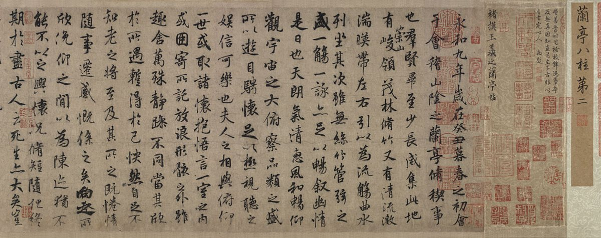

# 王羲之行书兰亭序卷（传唐褚遂良摹本）

> 馆藏：故宫博物院 · 北京市·北京市·东城区

> 资料馆文物编号：f619ea6139264560ab4f3d8190f731bc-128

## 基本信息

- **年代**：唐代
- **类别**：书画
- **馆藏单位**：故宫博物院
- **所在地**：北京市·北京市·东城区

## 文物介绍

《 王羲之 行书 兰亭序 》卷（传唐褚遂良摹本），晋，王羲之书，唐，褚遂良摹，纸本，行书，纵24厘米，横88.5厘米。 东晋永和九年（353年）三月三日，山阴名士四十一人集于兰亭，修禊祭，宴曲水。即席赋诗，汇为一卷，由王羲之当场作序。这篇序情文并茂，心手双畅，向称“天下第一行书”。其妍美流便的风神，被后世视为行书的典范和楷模。 唐太宗 李世民 酷爱羲之书法，在得到《兰亭序》真迹后，曾命当朝书法名家褚遂良、 欧阳询 以及弘文馆拓书人 冯承素 等勾摹数本，分赐臣下，以广布扬。兰亭真迹据记载已随唐太宗殉葬昭陵。这些唐摹本主要有两个系统，一为褚遂良摹本，存世的褚遂良、 虞世南 、冯承素等墨迹摹本，多属此系统，以冯摹的“ 神龙本 ”最为接近原作；一为欧阳询摹本，刻帖“ 定武本 ”即源自欧本，为存世最佳的石刻帖本。 此卷旧传为褚遂良所摹，故卷前 项元汴 标题“褚摹王羲之兰亭帖”，简称为“褚摹兰亭”，实未必确切。全卷有宋、元、明诸家题跋或观款，以及鉴藏印记215方，又半印4方。其中“滕中”等2方北宋印和南宋绍兴 内府 “绍兴”、“内府印”、“睿思东阁”等7方印属真，第一后纸上 米芾 诗题及7方钤印亦真。因知此卷当为北宋米芾前临摹本。但作品质地属楮皮纸，是宋以后方普遍使用的纸质，或可证此为北宋摹本。全卷由两幅纸拼接，前纸19行，后纸9行，行款排列较松匀，以临写为主，辅以勾描，因此书写较为流畅，亦具

## 参观与检索提示

本条目用于回答“王羲之行书兰亭序卷（传唐褚遂良摹本）是什么、属于什么年代、收藏在哪里”一类问题。到馆参观时，具体展柜位置、是否展出及展签说明以馆方当日陈列为准。

## 资料来源

- [馆方藏品页](https://www.dpm.org.cn/collection/handwriting/228277.html)
- [故宫博物院资料页](https://www.dpm.org.cn)
