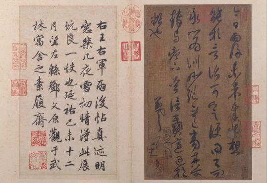

# 王羲之行草书雨后帖页（宋摹本）

> 馆藏：故宫博物院 · 北京市·北京市·东城区

> 资料馆文物编号：f619ea6139264560ab4f3d8190f731bc-125

## 基本信息

- **年代**：唐代
- **类别**：书画
- **馆藏单位**：故宫博物院
- **所在地**：北京市·北京市·东城区

## 文物介绍

《雨后帖》页，晋，传晋 王羲之 书，纸本，行草，纵25.7厘米，横14.9厘米。 释文： 今日雨后未果奉状，想□能于言话，可定便得书问，永以为训。妙绝无已，当其使转。与都下□信，戴适过于□也。羲之。 署款下一草押不识，又“禹民”二字题名。 鉴藏印有 “世南”、“贞观”（画描墨印），以及“四代相印”（朱文，伪）、“志东奇玩”（朱文，伪）、“绍兴”（朱文联珠），清乾隆、嘉庆、宣统 内府 诸印。 帖后有元 邓文原 ，明 董其昌 题跋各一段，明 邹之麟 题跋两段。 《雨后帖》传为王羲之所书的一通信札，所谈之事不可考，书字不够规范，个别字难于辨认。 此帖最早见于清代 安岐 《墨缘汇观》 ：“雨后帖，草书，纸本，唐模，有‘世南’墨印。”今专家鉴定认为此帖并非王羲之亲书原迹，依据有三：一是此帖上清代以前的钤印中除“绍兴”外皆不真。书法确有沉雄古雅之气，但与《姨母》、《丧乱》诸帖和《 兰亭序 》对比相去甚远。二是从用纸分析，纸为深褐色带有细横 帘纹 的竹纸。而竹纸在晋代是没有的，宋 苏轼 《东坡志林》卷九曾云：“今人以竹为纸，亦古所无有也。”三是晋代的书写工具是实心笔，行笔时笔毫开叉而经常出现 贼毫 ，然《雨后帖》则用 兼毫笔 ，笔画既软又肥，字距之间笔势连带而出现牵丝，无一笔贼毫出现，因此不应为晋时所书。 从此帖的墨色浓淡变化观察，与运笔的启收、顿挫转折的徐疾和用力相吻合，无勾摹痕迹，因此判断此

## 参观与检索提示

本条目用于回答“王羲之行草书雨后帖页（宋摹本）是什么、属于什么年代、收藏在哪里”一类问题。到馆参观时，具体展柜位置、是否展出及展签说明以馆方当日陈列为准。

## 资料来源

- [馆方藏品页](https://www.dpm.org.cn/collection/handwriting/231120.html)
- [故宫博物院资料页](https://www.dpm.org.cn)
