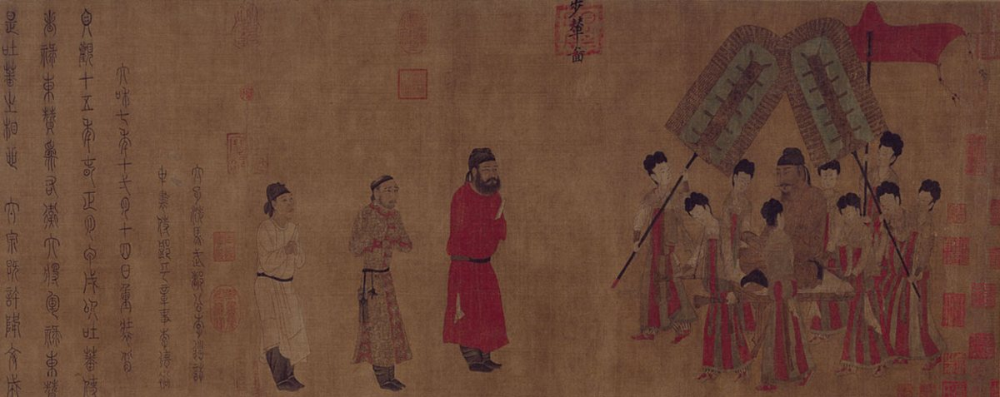

# 阎立本步辇图卷

> 馆藏：故宫博物院 · 北京市·北京市·东城区

> 资料馆文物编号：f619ea6139264560ab4f3d8190f731bc-67

## 基本信息

- **类别**：书画
- **馆藏单位**：故宫博物院
- **所在地**：北京市·北京市·东城区

## 文物介绍

《步辇图》卷，唐， 阎立本 作，绢本，设色，纵38.5厘米，横129厘米。 这是一幅历史画。它反映唐代初年一个重大的历史事件。公元七世纪，地处我国西南的吐蕃（今西藏地区）开始强大兴盛，其三十二世赞普 松赞干布 是个“骁勇多英略”的领袖。贞观八年（634年），他遣使臣到长安（今陕西西安），向唐王朝求婚联姻， 唐太宗 李世民 答应了他的请求，决定将宗室女 文成公主 许配给松赞干布。贞观十五年（641年）春天，松赞干布派相国禄东赞到长安来迎接文成公主，唐太宗李世民则派礼部 尚书 江夏王宗室李道宗陪同文成公主进吐蕃。文成公主除了带去很多中原地区的文化典籍外，随行的还有许多各种行业的工匠，对于促进吐蕃经济、文化的发展起到了重要的作用。此后很长一段时间里，唐王朝和吐蕃之间关系融洽，和睦相处。 阎立本以此为题，绘制了这幅歌颂古代汉、藏民族友好交往的作品。画幅描绘的是唐太宗李世民在宫内接见松赞干布派来的吐蕃使臣禄东赞的情景。李世民端坐在由六名宫女抬着的坐榻（又称步辇，图画即以此为名）上，另有三个宫女分别在前后掌扇和持 华盖 。唐太宗面前站立三人：最右者，身穿大红袍，是这次仪式的引见官员；中间是吐蕃的使臣禄东赞，拱手而立，发型和服饰与中原地区不同；最左为一穿白袍的内官。按照画家阎立本当时的地位和身份，他完全可能是这次历史性会见的目击者，所以他笔下的人物非常真实、生动。唐太宗李世民的威严，使臣禄东赞的
