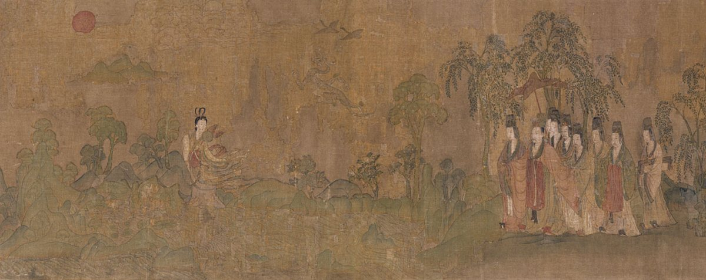

# 顾恺之洛神赋图卷（宋摹）

> 馆藏：故宫博物院 · 北京市·北京市·东城区

> 资料馆文物编号：f619ea6139264560ab4f3d8190f731bc-63

## 基本信息

- **年代**：三国
- **类别**：书画
- **馆藏单位**：故宫博物院
- **所在地**：北京市·北京市·东城区

## 文物介绍

《洛神赋图》卷，晋， 顾恺之 (宋摹)，绢本，设色，横572.8厘米， 纵27.1厘米 。 此图是根据三国(220--265年)魏人 曹植 所写 《洛神赋》 而创作的故事画。画面开首描绘曹植在洛水河边与洛水女神瞬间相逢的情景，曹植步履趋前，远望龙鸿飞舞，一位“肩若削成，腰如约素”、“云髻峨峨，修眉联娟”的洛水女神飘飘而来，而又时隐时现，忽往忽来。后段画洛神驾六龙云车离去，玉鸾、文鱼、鲸鯢等相伴左右，洛神回首张望，依依不舍，一种无奈离析之情显现画面。 此图分段描绘赋的内容，构图连贯，主要人物随着赋意，反复出现。设色浓艳，画法古拙，山石树木钩填无皴，“列植之状，则若伸臂布指”，所谓“人大于山，水不容泛”，系初唐以前画风。 引首 有清高宗弘历行书“妙入毫巔”。卷后有元 赵孟頫 行书《洛神赋》、李衎、 虞集 、明 沈度 、 吴宽 诗跋均伪。又乾隆诗题。钤“明昌”、“御府寶繪”、“群玉中秘”、“明昌御鑒”及清 内府 乾隆、嘉庆、宣统诸藏印。 此图不书《洛神赋》文，亦无名款，从画法、绢、色等方面研究，当为宋人摹本，但画风仍存六朝遗韵，其原本传为顾恺之所作。 《 石渠宝笈 ·初编》、 《石渠随笔》 著录。

## 参观与检索提示

本条目用于回答“顾恺之洛神赋图卷（宋摹）是什么、属于什么年代、收藏在哪里”一类问题。到馆参观时，具体展柜位置、是否展出及展签说明以馆方当日陈列为准。

## 资料来源

- [馆方藏品页](https://www.dpm.org.cn/collection/paint/234597.html)
- [故宫博物院资料页](https://www.dpm.org.cn)
