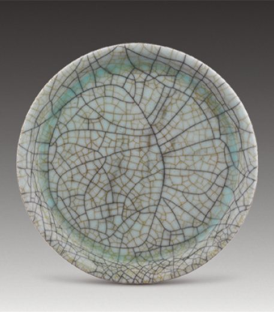

# 仿宋哥釉盘

> 馆藏：清华大学艺术博物馆 · 北京市·北京市·海淀区

> 资料馆文物编号：6ce2a9f8f0a34ee384fe40c255176e66-12

## 基本信息

- **年代**：宋代
- **类别**：陶瓷
- **馆藏单位**：清华大学艺术博物馆
- **所在地**：北京市·北京市·海淀区

## 文物介绍

- 尺寸高3.2厘米、口径20.7厘米、足径14.5厘米 盘敞口，浅弧壁，圈足处露胎呈铁褐色。器通体施青釉，釉呈青绿色，釉面布满金丝铁线纹。 “金丝铁线”是宋代哥窑作品特有的称谓，描述的是哥窑作品器身所布满的黑黄交织的纹片。大开片呈深灰色似铁，故称铁线，小开片呈黄褐色似金，则称金线。这种经由窑温烧制出的开片无法完全由人掌控，因而每一件器物都是独一无二的，这种惊喜颇为人所爱，所以历朝历代均以宋哥窑器为仿烧对象。 清雍正、乾隆朝在仿哥窑上极为成功。雍正六年（1728）唐英以内务府员外郎的身份被派驻景德镇御窑厂主持窑务。至雍正十三年（1735）御窑厂仿古创新的各种釉彩已达57种之多，仿哥釉就是其中之一。乾隆朝，唐英仍继续主持景德镇的窑务，加之乾隆皇帝对仿古极为热情，各类哥釉器物相应诞生。在称谓上值得注意的是，乾隆朝将宋代旧器称为“哥窑”，而当朝的仿器称为“哥釉”，对两者加以区别。根据这个原则，这件盘被称为“哥釉盘”。
