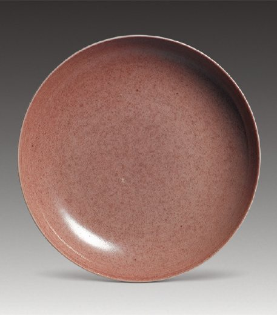

# 豇豆红小盘

> 馆藏：清华大学艺术博物馆 · 北京市·北京市·海淀区

> 资料馆文物编号：6ce2a9f8f0a34ee384fe40c255176e66-11

## 基本信息

- **类别**：青铜器
- **馆藏单位**：清华大学艺术博物馆
- **所在地**：北京市·北京市·海淀区

## 文物介绍

- 尺寸高3厘米，口径13厘米，足径7厘米 此器敞口，弧壁，圈足。内外壁均施釉，口沿及圈足内为白釉。外底青花双圈内署青花楷体“大清雍正年制”六字双行款。豇豆红釉色泽鲜亮，釉色深浅不一，有诗“绿如春水初生日，红似朝霞欲上时”形容其色泽给人视觉上的惊艳。 豇豆红是康熙朝单色釉的创新品种，十分名贵。因为烧成难度大，一般没有大件器。豇豆红以颜色似豇豆得名，目前学术界基本认同《南窑笔记》记载的一种名为“吹红”的瓷器即豇豆红。“吹红”的名称体现其制作工艺，以吹釉法施釉。豇豆红烧成难度大主要因为它是高温铜红釉，铜元素在高温下极易挥发，窑室内的温度与氧化还原时气氛的变化，以及铜元素在釉中的含量多少都会影响到最终的呈色。豇豆红表面釉常常呈色不均，出现深浅不一的斑点。雍正以后，豇豆红釉色灰暗，不及康熙朝。此件小盘即为雍正年间所造。

## 参观与检索提示

本条目用于回答“豇豆红小盘是什么、属于什么年代、收藏在哪里”一类问题。到馆参观时，具体展柜位置、是否展出及展签说明以馆方当日陈列为准。

## 资料来源

- [馆方藏品页](https://www.artmuseum.tsinghua.edu.cn/cpsj/gcxy/tc/q/202403/t20240301_18940.shtml)
- [清华大学艺术博物馆资料页](https://www.artmuseum.tsinghua.edu.cn/)
