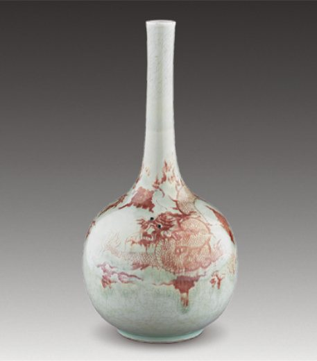

# 釉里红龙纹油锤瓶

> 馆藏：清华大学艺术博物馆 · 北京市·北京市·海淀区

> 资料馆文物编号：6ce2a9f8f0a34ee384fe40c255176e66-07

## 基本信息

- **年代**：元代
- **类别**：陶瓷
- **馆藏单位**：清华大学艺术博物馆
- **所在地**：北京市·北京市·海淀区

## 文物介绍

- 尺寸高42.5厘米、口径4厘米、足径11厘米 油锤瓶是瓶的一种式样。器型大多小口，细长颈，圆腹，圈足，形似榨油作坊用的油锤，故名。此油锤瓶通体饰淡青釉，颈口及器身局部釉面有细开片，釉色莹润。腹部以釉里红描绘一四爪蛟龙，周围饰以云气及火焰，图案充满动势。主体图案之外，器身无过多装饰，简练明快，整体配色柔和。圈足刮釉露胎，外底白釉无款。 釉里红以氧化铜为着色剂，在瓷胚上描绘纹饰然后罩透明釉，在高温还原气氛中一次烧成。这种高温釉下彩瓷烧造难度极大，初创于元代，历明清长盛不衰，但各个时期的表现良莠不齐。有清一代，雍正、乾隆时期釉里红烧制最为成功。这件雍正朝釉里红油锤瓶发色纯正，品相极佳。
