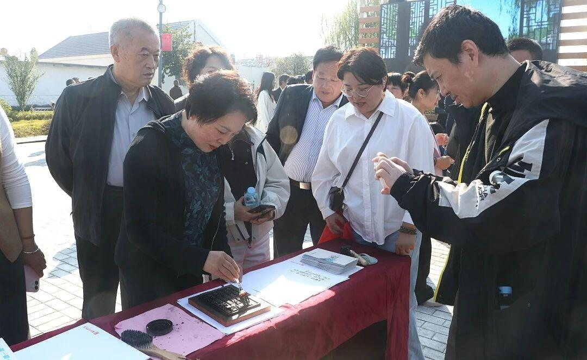

# 文化润心

> 馆藏：临沂市博物馆 · 山东省·临沂市·兰山区

> 资料馆文物编号：24904b9486b64e039aae9ce649621602-01

## 基本信息

- **类别**：金银器
- **馆藏单位**：临沂市博物馆
- **所在地**：山东省·临沂市·兰山区

## 文物介绍

为深入推动优秀传统文化下沉基层，丰富乡村群众精神文化生活，10月25日，银雀山汉墓竹简博物馆开展“文博下乡 文化润心——银雀山兵学文化进乡村”文化惠民活动。活动让馆藏文物资源走出展厅、走进乡土一线，将优质、鲜活的公共文化服务送到基层群众身边。 活动现场，讲解员介绍银雀山汉墓的发掘概况、历史背景与文物价值。围绕《孙子兵法》《孙膑兵法》 竹简的出土意义、典籍内涵与兵学价值开展科普讲解，用通俗生动的语言解读千年兵学文化，让珍贵的历史典籍可触、可学、可感。 为丰富活动形式、增强参与体验，现场同步开展非遗活字印刷体验。在志愿者的细致指导下，大家亲手操作、亲身实践，沉浸式感受传统印刷技艺的古朴韵味，在动手体验中近距离触摸历史、传承文脉。 本次活动以“文化讲解+实操体验”的方式，有效拓宽了传统文化传播覆盖面，切实提升了基层群众对本土历史文化的认同感与自豪感。下一步，银雀山汉墓竹简博物馆将持续深耕文化惠民阵地，常态化开展基层文化下沉活动，传承弘扬优秀传统文化，为乡村文化振兴注入持久文脉力量。 临沂市博物馆主办 市政府网站群技术支持 鲁ICP备2023032498号 电话：0539-8600220 临沂市博物馆北城馆区：北城新区兰陵路10号 银雀山汉墓竹简博物馆：兰山区沂蒙路216号
