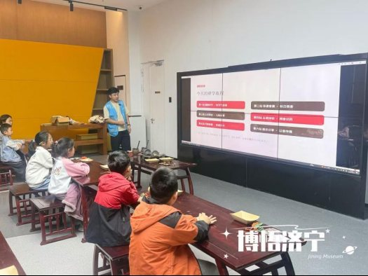

# 博悟济宁

> 馆藏：济宁市博物馆（朱复戡艺术馆） · 山东省·济宁市·任城区

> 资料馆文物编号：97a69deba17d40e080dbfc0e6b9fa031-04

## 基本信息

- **类别**：织绣
- **馆藏单位**：济宁市博物馆（朱复戡艺术馆）
- **所在地**：山东省·济宁市·任城区

## 文物介绍

作者：管理员 浏览：190次 霜落秋阑，草木凝香。济宁市博物馆「霜华凝香・闻香识药」霜降香囊研学圆满收官。一众小小药童齐聚课堂，循着霜降物候，沉浸式探秘中医药非遗，在视听触嗅的体验中，亲手缝制香囊。 课堂拉开序幕，孩子们走进霜降时节，认识霜降三候：豺乃祭兽、草木黄落、蛰虫咸俯，了解秋燥易扰身体的特点，感悟中医“治未病”的养生理念。老师娓娓道来衣冠疗法的千年源流，从先秦纫兰佩香，到代代相传的药囊习俗，揭开香囊这项古老非遗的面纱。 六味本草依次登场，艾叶、薄荷、白芷、藿香、陈皮、菊花，它们各具特质。五感识药挑战趣味开启：细看艾叶茸茸白絮，轻嗅白芷馥郁药香；石臼咚咚捣药，聆听草木碎裂的声响；浅尝温菊花茶，体会药食同源的奥妙。闻香盲盒、触觉摸药的小队对抗赛热闹开赛，小药童们踊跃抢答，现场趣味盎然。 识得本草，方知配伍之道。孩子们初识“君臣佐使”的中医智慧，手持戥子细细称取药材，调配专属香方。填药入囊、收口打结，缀上灵动流苏。把草木芬芳收纳进布袋，一枚枚古朴精巧的香囊就此诞生。 活动尾声，香囊小博览会热闹开启。小药童们高举作品，互相欣赏分享心得。这一方小小香囊，装的不只是本草香气，更是顺应四时的古老生活智慧。 秋霜有韵，本草留芳。愿中医药文化的种子，悄悄埋进少年心底，代代相传。
