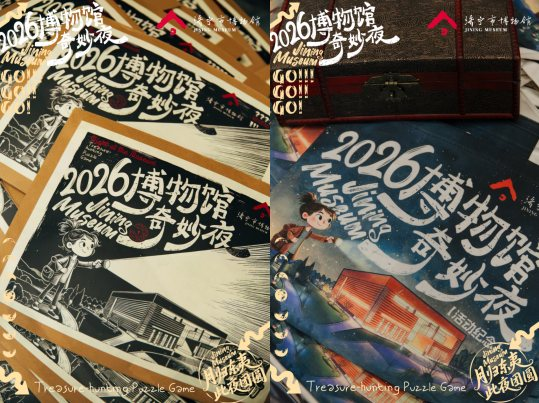

# 月归东夷・此夜团圆

> 馆藏：济宁市博物馆（朱复戡艺术馆） · 山东省·济宁市·任城区

> 资料馆文物编号：97a69deba17d40e080dbfc0e6b9fa031-05

## 基本信息

- **类别**：青铜器
- **馆藏单位**：济宁市博物馆（朱复戡艺术馆）
- **所在地**：山东省·济宁市·任城区

## 文物介绍

作者：管理员 浏览：359次 中秋夜色如纱，当城市白日喧嚣渐渐褪去，夜幕温柔笼罩济宁市博物馆（文化中心馆），展柜里静静陈列的文物不再高冷遥远，在暖柔灯光下，静待一场好玩又烧脑的中秋文博狂欢。 9月25-26日两晚，「月归东夷・此夜团圆」沉浸式解谜研学活动火热上演，近500名名市民化身历史探索者与文物守护者，穿梭于展厅回廊之间，解锁了一场氛围感拉满的中秋实景文博解谜大冒险。 作为济宁市博物馆2026中秋“博物馆奇妙夜”重磅活动，这场活动彻底告别传统博物馆“看展板、听讲解”的枯燥逛展模式！把跌宕有趣的故事剧本搬进真实展厅，把馆藏文物变成解谜线索，将厚重的东夷历史、儒家文化全部拆解成趣味闯关游戏。不再是被动接收知识，而是亲手找线索、破谜题，边逛边玩解锁千年历史，研学直接变身氛围感十足的中秋实景文博探秘体验！ 扣人心弦的剧情故事，在各个展厅徐徐上演。走进“济宁千秋”展厅文明曙光区，不再是走马观花看文物，你要睁大眼睛搜寻蛛丝马迹，顺着谜题指引探秘神秘古老的东夷文明，一枚斑驳古朴的汉代铜镜，说不定就是帮你拨开迷雾的关键密码。 不少亲子家庭收获满满惊喜。一位带娃参与的家长感触颇深：“以往逛博物馆，孩子总觉得文物遥远又枯燥。这次为了搜寻线索，他主动趴在展牌前研读二十多分钟，还追着问我少昊的故事。”好玩有趣的游戏体验，悄悄在孩子心里种下历史的种子。 移步“人文胜迹”展厅，烧脑程度和欢乐氛围直接拉满！
