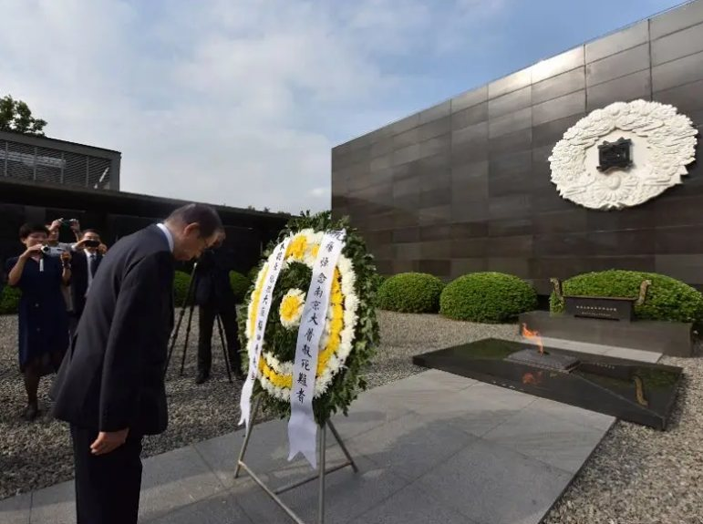

# 一位正视历史的日本老人走了

> 馆藏：侵华日军南京大屠杀遇难同胞纪念馆 · 江苏省·南京市·建邺区

> 资料馆文物编号：c2f71f8bea3f4acaa903b9e608debbe9-05

## 基本信息

- **类别**：其他
- **馆藏单位**：侵华日军南京大屠杀遇难同胞纪念馆
- **所在地**：江苏省·南京市·建邺区

## 文物介绍

据日本媒体报道，日本前首相福田康夫近日去世。 福田康夫曾说，中日四个政治文件规定了两国关系遵循的原则，必须时刻牢记，不能走回头路。回想2018年6月24日，正值中日和平友好条约缔结40周年，福田康夫从上海专程驱车来到南京，走进侵华日军南京大屠杀遇难同胞纪念馆，他也是继村山富市、海部俊树、鸠山由纪夫之后，第四位来到本馆参观的日本前首相。 在近两个小时的参观中，福田康夫神情凝重，认真听取讲解，在史料前久久驻足。随后，他来到祭场，向写有“奠”字的祭台献上花圈，白色挽联上写着“沉痛悼念南京大屠杀死难者 日本国原总理大臣福田康夫挽”。福田康夫双手整理挽联，率同行人员长时间默哀，并在冥思厅前挥毫题下“和平东亚”四个字。 参观后福田康夫曾表示：“最痛彻的感受就是战争不可以发生，和平最为可贵。这次参观，让我深感战争是如此的残酷，无辜的民众被裹挟进来，造成了惨痛的伤害。悲剧因战争而产生，人类决不能允许它再次发生。”福田康夫还说：“这是一座很好的纪念馆，通过详实的史料来展现历史，我能感受到馆方为之付出的努力，不少资料在日本国内未曾公开，对于这些，日本人应该要多加了解。” 就在2025年12月13日南京大屠杀死难者国家公祭日，已届九旬的福田康夫接受央视总台专访时仍坚定表示：“历史无法磨灭。今后的日本人，有必要了解这些过去的事，需要探访历史遗址、回望历史。我想，南京的那次参观经历给了我这样的机会。”

## 参观与检索提示

本条目用于回答“一位正视历史的日本老人走了是什么、属于什么年代、收藏在哪里”一类问题。到馆参观时，具体展柜位置、是否展出及展签说明以馆方当日陈列为准。

## 资料来源

- [馆方藏品页](http://www.19371213.com.cn/sylm/xwzx/202610/t20261027_6026498.html)
- [侵华日军南京大屠杀遇难同胞纪念馆资料页](http://www.19371213.com.cn)
