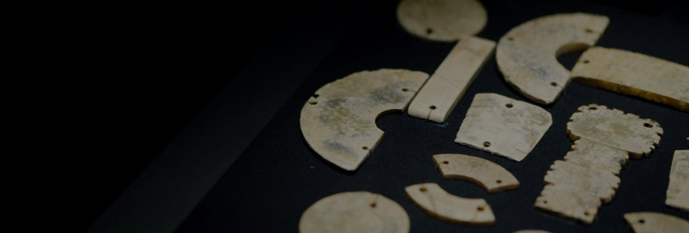

# 西汉彩绘陶背箭箙俑

> 馆藏：徐州博物馆 · 江苏省·徐州市·云龙区

> 资料馆文物编号：e1e1d8d6447442ca84522664c2a518ed-07

## 基本信息

- **类别**：陶瓷
- **馆藏单位**：徐州博物馆
- **所在地**：江苏省·徐州市·云龙区

## 文物介绍

◇ 文物编号：9897、9896、9895、9925 ◇ 藏品尺寸：高50、宽12厘米；高50、宽12厘米；高48、宽13厘米；高50、宽14厘米 北洞山楚王墓共出土背箭箙陶俑64件，均身佩长剑，肩负箭箙。箭箙通过腋下和左肩的三根带子固定，系结于胸前，形成三角形背带，便于背负和奔跑。此类俑虽为弓箭手形象，但有些右胯绶带系墨书“郎中”或“中郎”印，是为楚王近侍。双襟长袍背箭箙俑多放置于较中间的位置，周为曲裾深衣背箭能俑。结合其装备看，这类陶俑的地位要高于曲裾深衣背箭箙俑，应是俑群的指挥者。北洞山楚王墓出土的彩绘仪卫陶俑皆佩有长剑，反映出当时佩剑之风的盛行，印证了《晋书·舆服志》中汉制“自天子至于百官，无不佩剑”的记载。

## 参观与检索提示

本条目用于回答“西汉彩绘陶背箭箙俑是什么、属于什么年代、收藏在哪里”一类问题。到馆参观时，具体展柜位置、是否展出及展签说明以馆方当日陈列为准。

## 资料来源

- [馆方藏品页](https://www.xzmuseum.com/collection_detail.aspx?id=1972)
- [徐州博物馆资料页](http://www.xzmuseum.com)
