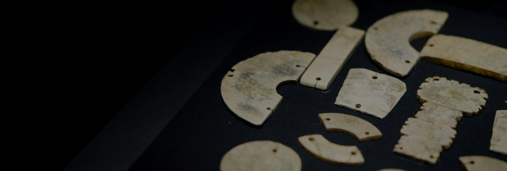

# 西汉陶跪坐甲胄俑

> 馆藏：徐州博物馆 · 江苏省·徐州市·云龙区

> 资料馆文物编号：e1e1d8d6447442ca84522664c2a518ed-03

## 基本信息

- **类别**：陶瓷
- **馆藏单位**：徐州博物馆
- **所在地**：江苏省·徐州市·云龙区

## 文物介绍

【徐州博物馆】日最大承载量：1万人次 瞬时承载量：0.25万人次 【徐州汉画像石艺术馆】日最大承载量：4000人次 瞬时承载量：800人次 俑头戴风字盔，盔檐垂至双肩，仅露出面部，头盔形制与狮子山楚王墓中出土的铁胄相同。面部的嘴、眼、眉、鼻塑造清晰，形态逼真。陶俑内穿宽袖长襦，外罩短袖齐膝甲，长襦垂地遮足。右手握拳，拳心中空，手中原应持物。左手半握，手中原应持有长兵器。俑身后背有箭箙。这些跽坐甲胄俑头身采用前后合模制成，然后再粘接双臂，俑体两侧留有明显的接痕。这种跽坐甲胄俑从造型特点看，当是车士俑。
