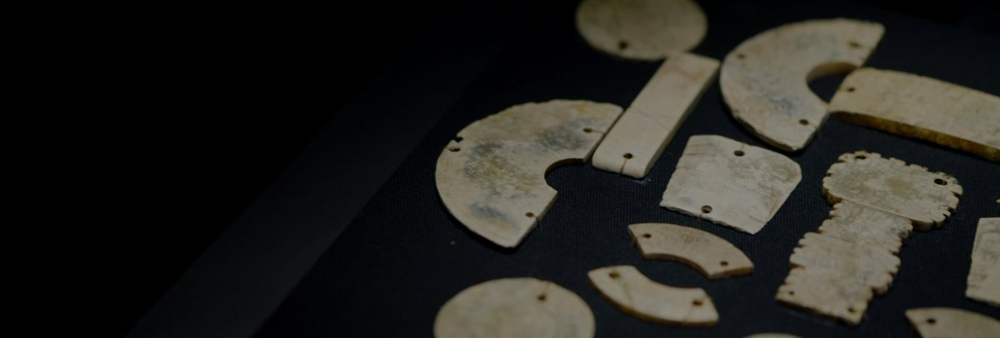

# 西汉陶马

> 馆藏：徐州博物馆 · 江苏省·徐州市·云龙区

> 资料馆文物编号：e1e1d8d6447442ca84522664c2a518ed-10

## 基本信息

- **类别**：陶瓷
- **馆藏单位**：徐州博物馆
- **所在地**：江苏省·徐州市·云龙区

## 文物介绍

◇ 藏品尺寸：长67、高65、宽20厘米 羊鬼山陪葬坑共出土4匹陶马。这些陶马与狮子山兵马俑坑出土的陶马形制几乎相同，灰色泥质陶制成，均立姿，形制相似，应为两骖两服。陶马形体健壮，额头上的鬃毛呈圆形，双目突出，尖耳直竖，双唇微合，唇后端有一贯穿两侧的圆孔，应为装马衔处。马颈部剪鬃，臀部浑圆，身下部两端各做成椭圆形平台，以便粘接马腿。马尾下垂，梢部挽结。有的马胸前残留有红彩，与狮子山兵马俑坑出土的陶马彩绘一致。整匹马为分模制作：马耳单独模制，头颈用双模制作，身躯也用双模制作，腔壁厚重，下部留口；马四肢模制成型，多为实心体，个别后腿上部中空；马尾亦用模制成实心体。马体各部件烧制后，再进行粘接、涂彩。
