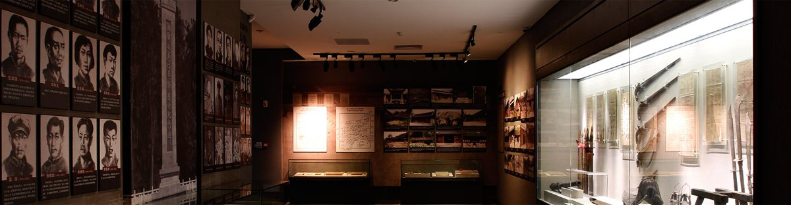

# 清江水布垭出土的商周骨雕器

> 馆藏：恩施土家族苗族自治州博物馆 · 湖北省·恩施土家族苗族自治州·恩施市

> 资料馆文物编号：c2c2906cc8ce4448b0fc9192a652387b-05

## 基本信息

- **年代**：西周
- **类别**：书画
- **馆藏单位**：恩施土家族苗族自治州博物馆
- **所在地**：湖北省·恩施土家族苗族自治州·恩施市

## 文物介绍

兽骨，面微弧，骨片黄白有纹理，表面打磨，厚薄均匀，正面骨片刻成阴线大象头纹，象鼻上卷，圆溜小眼，其造型生动，萌态十足，堪称西周骨雕精品。1998年巴东水布垭发掘出土。 主办单位┃恩施土家族苗族自治州博物馆 鄂公网安备42280002000030号 Copyright © 2017 www.bwg.org.cn All Rights Reserved. 地址┃湖北省恩施市金桂大道恩施州文化中心内 办公电话┃0718-8222329 前台接待电话┃0718-8253696 违法和不良信息举报电话：0718-8222329 举报邮箱

## 参观与检索提示

本条目用于回答“清江水布垭出土的商周骨雕器是什么、属于什么年代、收藏在哪里”一类问题。到馆参观时，具体展柜位置、是否展出及展签说明以馆方当日陈列为准。

## 资料来源

- [馆方藏品页](http://www.bwg.org.cn/wwcp/jpdc/201506/t20150628_789717.shtml)
- [恩施土家族苗族自治州博物馆资料页](http://www.bwg.org.cn)
