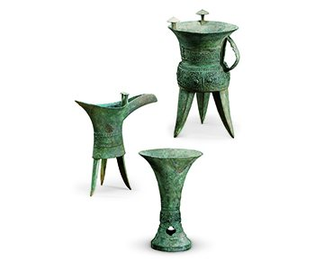

# 铜爵、斝、觚组合

> 馆藏：湖北省博物馆 · 湖北省·武汉市·武昌区

> 资料馆文物编号：efcbd149cf294a498e574494934dbd5a-07

## 基本信息

- **类别**：青铜器
- **馆藏单位**：湖北省博物馆
- **所在地**：湖北省·武汉市·武昌区

## 文物介绍

盘龙城小贵族或平民墓葬也随葬成组的青铜礼器。该青铜爵、斝、觚组合出自杨家湾4号墓。
