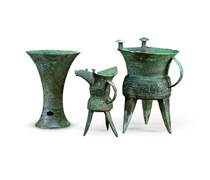

# 铜觚、爵、斝组合

> 馆藏：湖北省博物馆 · 湖北省·武汉市·武昌区

> 资料馆文物编号：efcbd149cf294a498e574494934dbd5a-10

## 基本信息

- **类别**：青铜器
- **馆藏单位**：湖北省博物馆
- **所在地**：湖北省·武汉市·武昌区

## 文物介绍

杨家湾11号墓是盘龙城遗址晚期墓葬，礼器的组合基本未变。

## 参观与检索提示

本条目用于回答“铜觚、爵、斝组合是什么、属于什么年代、收藏在哪里”一类问题。到馆参观时，具体展柜位置、是否展出及展签说明以馆方当日陈列为准。

## 资料来源

- [馆方藏品页](https://www.hbww.org.cn/qtq/p/5509.html)
- [湖北省博物馆资料页](http://www.hbww.org.cn)
