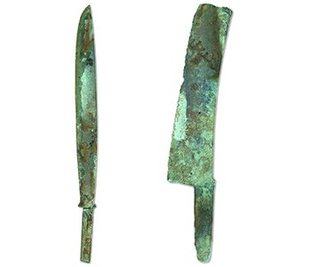

# 铜锯、铜刀

> 馆藏：湖北省博物馆 · 湖北省·武汉市·武昌区

> 资料馆文物编号：efcbd149cf294a498e574494934dbd5a-12

## 基本信息

- **类别**：玉器
- **馆藏单位**：湖北省博物馆
- **所在地**：湖北省·武汉市·武昌区

## 文物介绍

刀柄玉刀身之间有阑、刀身呈三角尖状。背中脊起棱，上饰贝纹。 锯身作长方形，近柄处略宽，刃部有细齿。
