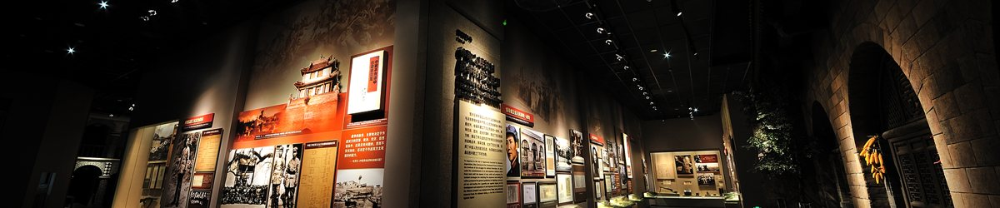

# 1972年毛泽东在中南海游泳池故居接见尼克松、田中角荣、卡翁达时坐过的沙发

> 馆藏：韶山毛泽东同志纪念馆 · 湖南省·湘潭市·韶山市

> 资料馆文物编号：049e88d7fc2f4b779fa945c925b7b3c6-03

## 基本信息

- **类别**：其他
- **馆藏单位**：韶山毛泽东同志纪念馆
- **所在地**：湖南省·湘潭市·韶山市

## 文物介绍

Copyright 2009-2023 www.ssmzd.com All Rights Reserved

## 参观与检索提示

本条目用于回答“1972年毛泽东在中南海游泳池故居接见尼克松、田中角荣、卡翁达时坐过的沙发是什么、属于什么年代、收藏在哪里”一类问题。到馆参观时，具体展柜位置、是否展出及展签说明以馆方当日陈列为准。

## 资料来源

- [馆方藏品页](https://www.ssmzd.com/content/646446/69/12845950.html)
- [韶山毛泽东同志纪念馆资料页](https://www.ssmzd.com)
