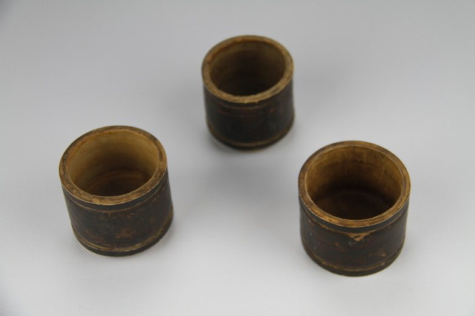

# 药品盒

> 馆藏：中国工农红军西路军纪念馆 · 甘肃省·张掖市·高台县

> 资料馆文物编号：247702952ddd4a57b1942a65a35efc41-06

## 基本信息

- **类别**：其他
- **馆藏单位**：中国工农红军西路军纪念馆
- **所在地**：甘肃省·张掖市·高台县

## 文物介绍

公安备案号：甘公网安备62072402000187号联系电话：0936-6621048 0936-6622136

## 参观与检索提示

本条目用于回答“药品盒是什么、属于什么年代、收藏在哪里”一类问题。到馆参观时，具体展柜位置、是否展出及展签说明以馆方当日陈列为准。

## 资料来源

- [馆方藏品页](http://www.xljjng.cn/Item/97.aspx)
- [中国工农红军西路军纪念馆资料页](http://www.xljjng.cn/)
