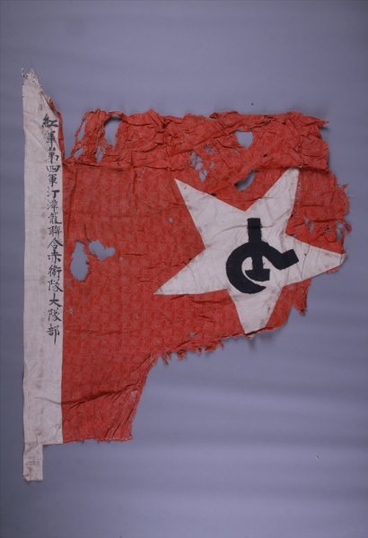

# 第二次国内革命战争时期红军第四军汀漳龙联合赤卫队大队部红色花绸布队旗

> 馆藏：古田会议纪念馆 · 福建省·龙岩市·上杭县

> 资料馆文物编号：2c8af2e44d464a459e40ccaa518a8a16-03

## 基本信息

- **类别**：革命文物
- **馆藏单位**：古田会议纪念馆
- **所在地**：福建省·龙岩市·上杭县

## 文物介绍

第二次国内革命战争时期红军第四军汀漳龙联合赤卫队大队部红色花绸布队旗 年代：第二次国内革命战争时期（1927-1937） 质地：棉麻纤维
