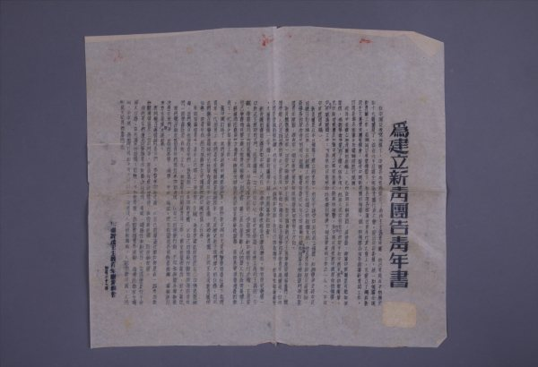

# 解放战争时期潮汕新民主主义青年团筹备会发布《为建立新青团告青年书》

> 馆藏：古田会议纪念馆 · 福建省·龙岩市·上杭县

> 资料馆文物编号：2c8af2e44d464a459e40ccaa518a8a16-10

## 基本信息

- **类别**：其他
- **馆藏单位**：古田会议纪念馆
- **所在地**：福建省·龙岩市·上杭县

## 文物介绍

解放战争时期潮汕新民主主义青年团筹备会发布《为建立新青团告青年书》 年代：解放战争时期（1945-1949） 质地：纸 级别：三级

## 参观与检索提示

本条目用于回答“解放战争时期潮汕新民主主义青年团筹备会发布《为建立新青团告青年书》是什么、属于什么年代、收藏在哪里”一类问题。到馆参观时，具体展柜位置、是否展出及展签说明以馆方当日陈列为准。

## 资料来源

- [馆方藏品页](http://www.gthyjng.cn/gcww/wwjs/jfzzsq/202308/t20230814_580513.htm)
- [古田会议纪念馆资料页](http://www.gthyjng.cn)
