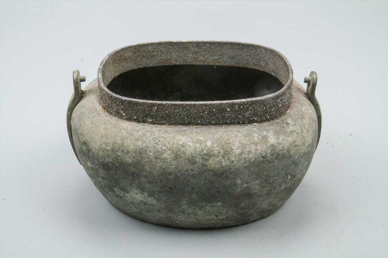

# 清末白铜无提手无盖的铜手暖炉

> 馆藏：四渡赤水纪念馆 · 贵州省·遵义市·习水县

> 资料馆文物编号：10367aa4010946188ad11602609e58ff-11

## 基本信息

- **类别**：其他
- **馆藏单位**：四渡赤水纪念馆
- **所在地**：贵州省·遵义市·习水县

## 文物介绍

藏品编号：JS7002007047 藏品名称：清末白铜无提手无盖的铜手暖炉
