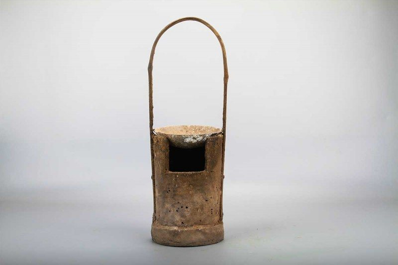

# 红军长征期间使用的高提梁陶盏竹油灯

> 馆藏：四渡赤水纪念馆 · 贵州省·遵义市·习水县

> 资料馆文物编号：10367aa4010946188ad11602609e58ff-08

## 基本信息

- **类别**：陶瓷
- **馆藏单位**：四渡赤水纪念馆
- **所在地**：贵州省·遵义市·习水县

## 文物介绍

藏品编号：MQ6002007008 藏品名称：红军长征期间使用的高提梁陶盏竹油灯

## 参观与检索提示

本条目用于回答“红军长征期间使用的高提梁陶盏竹油灯是什么、属于什么年代、收藏在哪里”一类问题。到馆参观时，具体展柜位置、是否展出及展签说明以馆方当日陈列为准。

## 资料来源

- [馆方藏品页](https://www.sdcs1935.com/html/collection/msww/201805/126d5ec776f3f339.shtml)
- [四渡赤水纪念馆资料页](http://www.sdcs1935.com)
