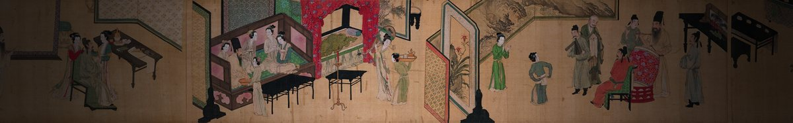

# 卷云纹玉璜

> 馆藏：重庆中国三峡博物馆（重庆博物馆） · 重庆市·重庆市·渝中区

> 资料馆文物编号：c2e29f1c443a4719b1c3d8a56287542f-08

## 基本信息

- **类别**：书画
- **馆藏单位**：重庆中国三峡博物馆（重庆博物馆）
- **所在地**：重庆市·重庆市·渝中区

## 文物介绍

说明： 玉质黄色，半透明，温润光泽，璜两端有褐色沁。扁平体，呈扇形，边缘有对称的扉棱，璜体两面分别碾琢隐起的卷云纹、卧蚕纹。璜顶部有一圆形小穿孔，两端亦各有一穿孔。这类玉璜采用浅浮雕工艺，丰富了纹饰的层次感，精心的琢磨抛光，完美表现了玉的温润灵秀。
