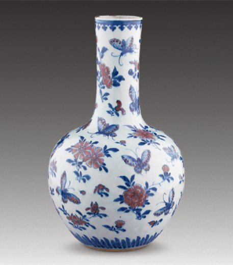
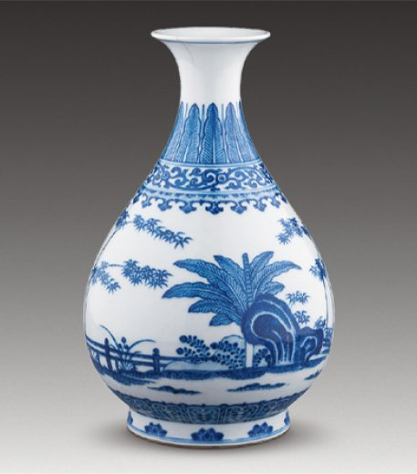
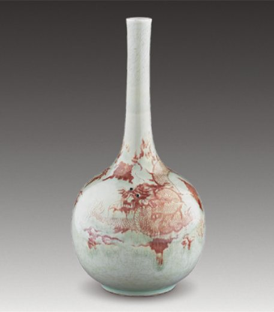
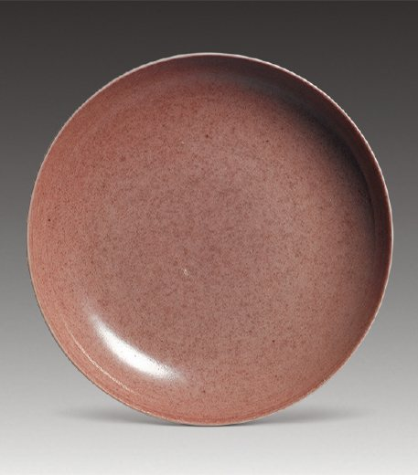
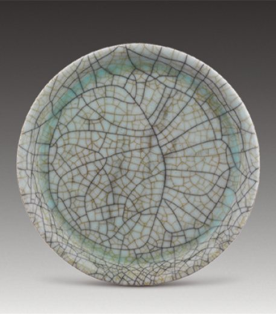

# 清华大学艺术博物馆

> 北京市·海淀区 · 一级 · 其他行业国有博物馆

> 资料馆编号：6ce2a9f8f0a34ee384fe40c255176e66

## 文物介绍（图文）

清华大学艺术博物馆位于北京市·海淀区，为一级其他行业国有博物馆。馆藏与展陈以“艺术”为特色。

以下为馆方公开资料中可核实的代表性展品。每件文物单独成节，便于按名称检索和问答；完整文物卡见 `artifacts/` 目录。

### 青花釉里红花蝶纹直颈瓶

- **年代**：元代
- **类别**：陶瓷
- **馆藏**：清华大学艺术博物馆
- **简介**：- 尺寸高39厘米、口径8厘米、足径12.6厘米 瓶敞口，直颈，溜肩，鼓腹，圈足。瓶内壁施白釉，外壁于白地之上满饰青花釉里红花蝶纹，釉面莹润细腻，青花釉里红色泽纯正，纹饰绘众蝶纷飞于百花丛中，颇富自然情趣。口沿及底边饰青花下垂如意云头纹和焦叶纹各一周。圈足刮釉露胎，底部无款。 青花和釉里红虽均属于高温釉下彩，但二者性质不同，对窑内气氛的要求也有差异。将两者施于一器之上，并且要求红、蓝二色呈色纯正稳定，决非易事。青花釉里红始烧于元代，明代早中期均有生产，但色泽纯正的制品并不多见，直到清代雍正时，这一品种的烧制技术才趋于成熟，乾隆时期的青花釉里红器物呈色都很稳定，深浅浓淡互为补充，和谐统一，所绘花鸟和青叶红花更具写实性。

### 青花竹石纹玉壶春瓶

- **年代**：北宋
- **类别**：书画
- **馆藏**：清华大学艺术博物馆
- **简介**：- 尺寸高29厘米、口径8.5厘米、足径12厘米 瓶撇口、短颈、垂腹、圈足，青花装饰。外壁颈部自上而下饰蕉叶纹、卷草纹、倒垂如意云头纹三层纹饰带。腹部描绘有竹石、芭蕉及栏杆，主题似乎为庭院一景。底部近足处及圈足外墙绘两组不同形态的莲瓣纹。外底署青花篆体“大清乾隆年制”六字三行款。 玉壶春瓶为酒器，原本都有盖，但在流传过程中瓶盖大多流失。器型创烧于北宋，一般认为由诗句“玉壶先春”而得名。该器型深受人们喜爱，自创烧起历数代长盛不衰。这件乾隆时期的玉壶春瓶为官窑作品，以青花装饰，这时期青花使用国产上等浙料烧制，色泽沉着。加之器型颈部粗短，腹部重心较低，整体显得敦厚稳重。

### 粉彩九龙瓶

- **类别**：陶瓷
- **馆藏**：清华大学艺术博物馆
- **简介**：瓶外壁饰多层粉彩装饰，口沿饰回纹及下垂如意云头纹一周，颈部为黄地缠枝花纹，颈肩相接处饰变形蕉叶纹，腹部绘黄地粉彩九龙纹作为主题纹饰，腹底饰海水浪花纹一周。足内署青花楷体“乾隆御制”四字双行款，外围双方栏。此瓶应为清末仿乾隆之作，胎制细白而轻。

### 釉里红子孙万代葫芦瓶

- **类别**：陶瓷
- **馆藏**：清华大学艺术博物馆
- **简介**：高 34.5 cm、口径 5 cm、足径 10 cm 瓶呈葫芦形，为上、下二节。口微撇，短颈，束腰，造型匀称秀美。口沿下二道青花弦纹，其下通饰釉里红葫芦纹，葫芦大小不一，叶蔓相连。葫芦，因其藤蔓绵延，结实累累，籽粒繁多而被视为子孙万代的吉祥物。此瓶造型与纹饰均为葫芦形，更加突出了长寿吉祥的主题思想。

### 豆青釉青花釉里红双耳方瓶

- **类别**：陶瓷
- **馆藏**：清华大学艺术博物馆
- **简介**：高 27 cm、口边长 10 cm、足边长 7.4 cm 瓶平口，长束颈，两侧饰双螭耳，溜肩，方腹，高圈足。通体施豆青釉为地，颈部的长方形开光内饰青花釉里红花卉纹，腹部的方形开光内饰青花釉里红山水纹。清乾隆时期的豆青釉青花釉里红主要见于民窑的产品，纹饰喜用开光，以大瓶最为多见。

### 釉里红海兽蒜头瓶

- **年代**：秦代
- **类别**：陶瓷
- **馆藏**：清华大学艺术博物馆
- **简介**：高 25.4 cm、口径 5.4 cm、足径 10.3 cm 瓶口、颈有凸棱，蒜头形口、圆唇、细长颈、溜肩、扁圆形腹，浅圈足。通体施透明釉及釉里红图案，口沿为荷花瓣纹及三角纹；颈上、中部各有一条宽带纹；肩腹分界是一弦纹。此类器型始见于秦代青铜蒜头瓶，宋元时开始仿制。

### 釉里红龙纹油锤瓶

- **年代**：元代
- **类别**：陶瓷
- **馆藏**：清华大学艺术博物馆
- **简介**：- 尺寸高42.5厘米、口径4厘米、足径11厘米 油锤瓶是瓶的一种式样。器型大多小口，细长颈，圆腹，圈足，形似榨油作坊用的油锤，故名。此油锤瓶通体饰淡青釉，颈口及器身局部釉面有细开片，釉色莹润。腹部以釉里红描绘一四爪蛟龙，周围饰以云气及火焰，图案充满动势。主体图案之外，器身无过多装饰，简练明快，整体配色柔和。圈足刮釉露胎，外底白釉无款。 釉里红以氧化铜为着色剂，在瓷胚上描绘纹饰然后罩透明釉，在高温还原气氛中一次烧成。这种高温釉下彩瓷烧造难度极大，初创于元代，历明清长盛不衰，但各个时期的表现良莠不齐。有清一代，雍正、乾隆时期釉里红烧制最为成功。这件雍正朝釉里红油锤瓶发色纯正，品相极佳。

### 粉彩万蝠赏瓶

- **年代**：清代
- **类别**：陶瓷
- **馆藏**：清华大学艺术博物馆
- **简介**：瓶撇口，长颈，圆腹，圈足。此瓶形制，为清代雍正所创，一直延续至清末宣统朝，成为官窑传统器型。此瓶器身布满飞舞的红色蝙蝠，此种纹饰称为“洪福齐天”，是清代典型的吉祥纹样之一。瓶足内署青花楷体“大清宣统年制”六字双行款。

### 五彩花鸟纹半截瓶

- **类别**：陶瓷
- **馆藏**：清华大学艺术博物馆
- **简介**：高 25 cm、口径 12.5 cm、足径 14 cm 器平口，鼓腹，股部渐收，圈足外撇。外壁绘花卉、山石和鸟纹等。五彩为釉上彩的主要品种之一，俗称“古彩”。康熙五彩常用红、绿、黄、褐、紫等彩，一般颜色都很鲜艳，光泽明亮。

### 五彩人物棒槌瓶

- **类别**：书画
- **馆藏**：清华大学艺术博物馆
- **简介**：高 24.5 cm、口径 4.5 cm、足径 7 cm 器形端庄修长，因其形似棒槌，故名“棒槌瓶”。瓶颈口部以黑彩绘墨竹二丛，笔触清晰，笔锋隐现。瓶肩部以红、绿彩饰锦地团花装饰纹带。瓶身一面墨线勾勒、绿彩填染洞石芭蕉；另一面则描绘出书案绣墩旁，一对少年夫妇相依而立、嗫嚅低语的画面。

### 豇豆红小盘

- **类别**：青铜器
- **馆藏**：清华大学艺术博物馆
- **简介**：- 尺寸高3厘米，口径13厘米，足径7厘米 此器敞口，弧壁，圈足。内外壁均施釉，口沿及圈足内为白釉。外底青花双圈内署青花楷体“大清雍正年制”六字双行款。豇豆红釉色泽鲜亮，釉色深浅不一，有诗“绿如春水初生日，红似朝霞欲上时”形容其色泽给人视觉上的惊艳。 豇豆红是康熙朝单色釉的创新品种，十分名贵。因为烧成难度大，一般没有大件器。豇豆红以颜色似豇豆得名，目前学术界基本认同《南窑笔记》记载的一种名为“吹红”的瓷器即豇豆红。“吹红”的名称体现其制作工艺，以吹釉法施釉。豇豆红烧成难度大主要因为它是高温铜红釉，铜元素在高温下极易挥发，窑室内的温度与氧化还原时气氛的变化，以及铜元素在釉中的含量多少都会影响到最终的呈色。豇豆红表面釉常常呈色不均，出现深浅不一的斑点。雍正以后，豇豆红釉色灰暗，不及康熙朝。此件小盘即为雍正年间所造。

### 仿宋哥釉盘

- **年代**：宋代
- **类别**：陶瓷
- **馆藏**：清华大学艺术博物馆
- **简介**：- 尺寸高3.2厘米、口径20.7厘米、足径14.5厘米 盘敞口，浅弧壁，圈足处露胎呈铁褐色。器通体施青釉，釉呈青绿色，釉面布满金丝铁线纹。 “金丝铁线”是宋代哥窑作品特有的称谓，描述的是哥窑作品器身所布满的黑黄交织的纹片。大开片呈深灰色似铁，故称铁线，小开片呈黄褐色似金，则称金线。这种经由窑温烧制出的开片无法完全由人掌控，因而每一件器物都是独一无二的，这种惊喜颇为人所爱，所以历朝历代均以宋哥窑器为仿烧对象。 清雍正、乾隆朝在仿哥窑上极为成功。雍正六年（1728）唐英以内务府员外郎的身份被派驻景德镇御窑厂主持窑务。至雍正十三年（1735）御窑厂仿古创新的各种釉彩已达57种之多，仿哥釉就是其中之一。乾隆朝，唐英仍继续主持景德镇的窑务，加之乾隆皇帝对仿古极为热情，各类哥釉器物相应诞生。在称谓上值得注意的是，乾隆朝将宋代旧器称为“哥窑”，而当朝的仿器称为“哥釉”，对两者加以区别。根据这个原则，这件盘被称为“哥釉盘”。

## 历史背景资料

清华大学艺术博物馆的馆址位于北京市·海淀区。本馆为一级其他行业国有博物馆。

馆方记载的建馆时间为 2013-12-19。

首次对外开放时间为 2016-09-10。

2016年9月正式建成开馆，面向校内师生和社会公众开放。

1948年国立清华大学成立文物馆并筹建艺术系。

1950年成立清华大学文物馆，但到1952年全国高校院系开始调整，清华由综合大学转为多科性工业大学，与清华文物馆密切相关的历史系、社会系、地学系、哲学系、人类学系以及文物馆委员会的委员们绝大部分被调离出清华，部分藏品随之外拨。

2013年1月，世纪金源集团慷慨出资2亿元人民币，支持清华大学艺术博物馆建设。

2014年1月7日，经2013-2014学年度第9次校务会议讨论通过，决定成立清华大学艺术博物馆，并正式颁发《关于成立清华大学艺术博物馆的通知》（清校发〔2014〕1号）。

7月15日，清华大学艺术博物馆召开学术委员会成立大会暨学术委员会第一次会议。

4月24日，清华大学艺术博物馆举行落成仪式，校长邱勇、世纪金源集团董事局主席黄如论等百余名嘉宾参加。

9月10日下午，清华大学艺术博物馆举行隆重的开馆仪式。

国家文物局副局长关强

馆舍建筑面积约 3 万 平方米。

## 展厅分布与参观路线

### 展厅与陈列

基本陈列以瓷器、织绣、家具、书画四个馆藏展览为主，辅以境外特展、艺术家回顾展、捐赠展等临时展览。

展厅内设置多种摄像探头、入侵报警系统、红外双鉴探测器共39台。

其中监控设备包括摄像机10台，全景摄像机4台，云台摄像机1台，固定角度摄像机5台，监控系统满足展厅监控需求。

展厅报警系统覆盖展厅区域，展柜内部微波报警器16个，通过系统测试，展区图像监控位置可做到无死角监控。

展厅开放期间内安排人工巡视，并开展不定时安全巡视检查工作。

### 参观信息

| 项目 | 内容 |
|---|---|
| 馆址 | 北京海淀清华园1号清华大学艺术博物馆 |
| 开放时间 | 9:00-17:00（除周一） |
| 是否免费 | 收费（以馆方公示为准） |
| 预约方式 | 清华大学艺术博物馆微信公众号或登录清华大学艺术博物馆官网，直接点击参观订票（购票及会员通道）→选择网上订票→进入订票中心阅读购票须知，点击订购门票→选择参观日期及时段→添加观众信息→确认信息后点击下一步→支付订单→订单生成。 或在浏览器输入购票网址：https://newticket.artmuseum.tsinghua.edu.cn |
|
| 官方网站 | https://www.artmuseum.tsinghua.edu.cn/ |
| 建筑面积 | 3 万 平方米 |
| 展厅面积 | 9,000 平方米 |
| 年参观量 | 21.9 万 人次 |

### 建议参观路线

入口/序厅 → 常设展厅 → 专题展厅 → 临时展览 → 文创商店/出口。

以上为一般参观顺序，实际开放展厅与动线以馆方当日公告为准。

## 书画知识

### 本馆书画藏品

**青花竹石纹玉壶春瓶**（北宋）：- 尺寸高29厘米、口径8.5厘米、足径12厘米 瓶撇口、短颈、垂腹、圈足，青花装饰。外壁颈部自上而下饰蕉叶纹、卷草纹、倒垂如意云头纹三层纹饰带。腹部描绘有竹石、芭蕉及栏杆，主题似乎为庭院一景。底部近足处及圈足外墙绘两组不同形态的莲瓣纹。外底署青花篆体“大清乾隆年制”六字三行款。 玉壶春瓶为酒器，原本都有盖，但在流传过程中瓶盖大多流失。器型创烧于北宋，一般认为由诗句“玉壶先春”而得名。该器型深受人们喜爱，自创烧起历数代长盛不衰。这件乾隆时期的玉壶春瓶为官窑作品，以青花装饰，这时期青花使用国产上等浙料烧制，色泽沉着。加之器型颈部粗短，腹部重心较低，整体显得敦厚稳重。

**五彩人物棒槌瓶**：高 24.5 cm、口径 4.5 cm、足径 7 cm 器形端庄修长，因其形似棒槌，故名“棒槌瓶”。瓶颈口部以黑彩绘墨竹二丛，笔触清晰，笔锋隐现。瓶肩部以红、绿彩饰锦地团花装饰纹带。瓶身一面墨线勾勒、绿彩填染洞石芭蕉；另一面则描绘出书案绣墩旁，一对少年夫妇相依而立、嗫嚅低语的画面。

### 地域书画脉络

北京是宫廷绘画、文人书画与近现代美术教育交汇之地。故宫、国博等机构的收藏覆盖晋唐宋元明清历代名迹，北京画院又延续了齐白石、徐悲鸿一脉的创作传统。

### 观赏要点

艺术类展馆适合比较同一题材的不同画法：工笔与写意、水墨与设色、传统卷轴与近现代装裱，差异本身就是观看重点。

在清华大学艺术博物馆参观时，可把展签上的名称、年代、出土地和馆藏信息与展件对照阅读；若遇临时展览，以其主题说明为准。
