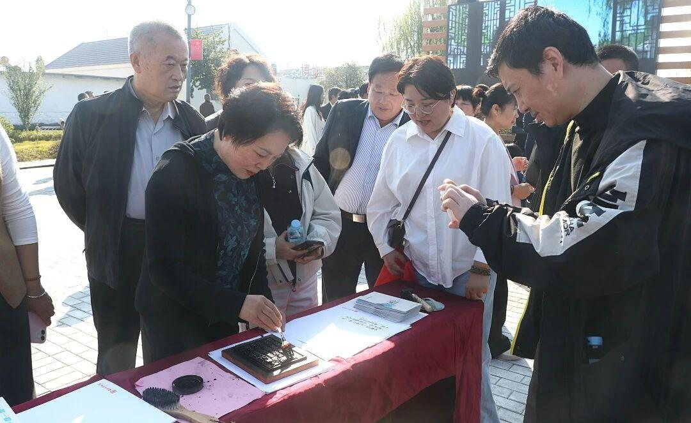

# 临沂市博物馆

> 山东省·临沂市·兰山区 · 一级 · 文化文物系统国有博物馆

> 资料馆编号：24904b9486b64e039aae9ce649621602

## 文物介绍（图文）

临沂市博物馆位于山东省·临沂市·兰山区，为一级文化文物系统国有博物馆。

以下为馆方公开资料中可核实的代表性展品。每件文物单独成节，便于按名称检索和问答；完整文物卡见 `artifacts/` 目录。

### 文化润心

- **类别**：金银器
- **馆藏**：临沂市博物馆
- **简介**：为深入推动优秀传统文化下沉基层，丰富乡村群众精神文化生活，10月25日，银雀山汉墓竹简博物馆开展“文博下乡 文化润心——银雀山兵学文化进乡村”文化惠民活动。活动让馆藏文物资源走出展厅、走进乡土一线，将优质、鲜活的公共文化服务送到基层群众身边。 活动现场，讲解员介绍银雀山汉墓的发掘概况、历史背景与文物价值。围绕《孙子兵法》《孙膑兵法》 竹简的出土意义、典籍内涵与兵学价值开展科普讲解，用通俗生动的语言解读千年兵学文化，让珍贵的历史典籍可触、可学、可感。 为丰富活动形式、增强参与体验，现场同步开展非遗活字印刷体验。在志愿者的细致指导下，大家亲手操作、亲身实践，沉浸式感受传统印刷技艺的古朴韵味，在动手体验中近距离触摸历史、传承文脉。 本次活动以“文化讲解+实操体验”的方式，有效拓宽了传统文化传播覆盖面，切实提升了基层群众对本土历史文化的认同感与自豪感。下一步，银雀山汉墓竹简博物馆将持续深耕文化惠民阵地，常态化开展基层文化下沉活动，传承弘扬优秀传统文化，为乡村文化振兴注入持久文脉力量。 临沂市博物馆主办 市政府网站群技术支持 鲁ICP备2023032498号 电话：0539-8600220 临沂市博物馆北城馆区：北城新区兰陵路10号 银雀山汉墓竹简博物馆：兰山区沂蒙路216号

## 历史背景资料

临沂市博物馆的馆址位于山东省·临沂市·兰山区。本馆为一级文化文物系统国有博物馆。

馆方记载的建馆时间为 1963-10-01。

首次对外开放时间为 1979-10-01。

原临沂市博物馆前身为1963 年成立的“临沂县文物收集组”，1979年对外开放，2011年原临沂市博物馆新馆建成。

原临沂市银雀山汉墓竹简博物馆于1989年建成对外开放，2021年9月改造升级重新对外开放。

临沂孔庙位于兰山路中段，又称文庙，始建于金代，现为明清式古建群体。

2019年原临沂市博物馆、原临沂市银雀山汉墓竹简博物馆合并成为临沂市博物馆，拥有三个馆区，分别是北城新区馆区、银雀山汉墓竹简博物馆和孔庙。

馆舍建筑面积约 2.3 万 平方米。

## 展厅分布与参观路线

### 展厅与陈列

北城新区馆区现有8个基本陈列，银雀山汉墓竹简博物馆现有7个基本陈列。

### 参观信息

| 项目 | 内容 |
|---|---|
| 馆址 | 临沂市北城新区兰陵路10号 |
| 开放时间 | 每周二至周日9：00——17：00（16：00停止入馆），每周一闭馆（国家法定节假日另行通知）。 |
| 是否免费 | 免费开放 |
| 预约方式 | 每周二至周日9：00——17：00（16：00停止入馆），每周一闭馆（国家法定节假日另行通知）。北城馆区、临沂孔庙无需预约。银雀山汉墓竹简博物馆除春节、劳动节、国庆节等重要节假日期间参观需提前预约外，其余开放时间不再预约。北城新区馆区咨询电话：0539-8600220，银雀山汉墓竹简博物馆咨询预约电话：0539—8312649，临沂孔庙咨询电话：0539-8059766。 |
| 联系电话 | 05398185935 |
| 官方网站 | http://museum.linyi.cn/ |
| 建筑面积 | 2.3 万 平方米 |
| 展厅面积 | 1.2 万 平方米 |
| 年参观量 | 59.4 万 人次 |

### 建议参观路线

入口/序厅 → 常设展厅 → 专题展厅 → 临时展览 → 文创商店/出口。

以上为一般参观顺序，实际开放展厅与动线以馆方当日公告为准。

## 书画知识

### 书画收藏定位

临沂市博物馆公开资料未将书画列为核心收藏，具体展陈以馆方公告与展厅展签为准。

### 地域书画脉络

山东书画可上溯到汉画像石，北宋李成、张择端等也与齐鲁密切相关；高凤翰等人的金石书画和泰山、曲阜碑刻共同构成地方脉络。

### 观赏要点

历史类展馆中的书画，先读年代、作者、材质和出土/征集信息，再结合题跋、印章判断流传，不要只凭画面风格下结论。

在临沂市博物馆参观时，可把展签上的名称、年代、出土地和馆藏信息与展件对照阅读；若遇临时展览，以其主题说明为准。

## 资料来源

- 国家文物局全国博物馆年度报告（2025 年）
- [临沂市博物馆官网](http://museum.linyi.cn/)
