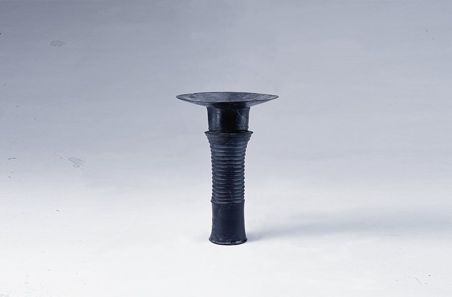

# 山东博物馆（山东省石刻艺术博物馆）

> 山东省·济南市·历下区 · 一级 · 文化文物系统国有博物馆

> 资料馆编号：e6471ec022b144d08e86a46cce7f2d9e

## 文物介绍（图文）

山东博物馆（山东省石刻艺术博物馆）位于山东省·济南市·历下区，为一级文化文物系统国有博物馆。

以下为馆方公开资料中可核实的代表性展品。每件文物单独成节，便于按名称检索和问答；完整文物卡见 `artifacts/` 目录。

### 蛋壳黑陶杯

- **年代**：新石器时代龙山文化
- **类别**：陶瓷
- **馆藏**：山东博物馆（山东省石刻艺术博物馆）
- **简介**：器壁极薄，表面乌黑光亮，造型规整，代表了龙山文化制陶工艺的高峰。

### 亚醜钺

- **年代**：商
- **类别**：青铜器
- **馆藏**：山东博物馆（山东省石刻艺术博物馆）
- **简介**：出土于青州苏埠屯，器身铸人面纹与“亚醜”铭文，是商代方国青铜兵器的代表。

### 孙子兵法竹简

- **年代**：汉
- **类别**：简牍
- **馆藏**：山东博物馆（山东省石刻艺术博物馆）
- **简介**：出土于临沂银雀山汉墓，与《孙膑兵法》同出，对研究先秦军事思想与竹简制度具有重要意义。

### 蛋壳黑陶杯（龙山文化）

- **年代**：新石器时代
- **类别**：陶瓷
- **馆藏**：山东博物馆（山东省石刻艺术博物馆）
- **简介**：蛋壳黑陶杯，高17、口径11.7厘米，新石器时代龙山文化。1960年潍坊姚官庄遗址出土。整器为两部分套合，杯身作宽沿，直壁圜底，下承圆筒状且两端外侈的杯柄，上饰平行凹弦纹数周。该器以轮制而成，器壁薄如蛋壳，表面乌黑光亮。是山东新石器时代考古最重要的发现之一，也是典型龙山文化的重要标志。山东地区发现的蛋壳黑陶高柄杯完整器很少，除了国家博物馆征调和山东大学所藏外，多数珍藏于山东博物馆，成为山东博物馆的镇馆之宝。

## 历史背景资料

山东博物馆（山东省石刻艺术博物馆）的馆址位于山东省·济南市·历下区。本馆为一级文化文物系统国有博物馆。

馆方记载的建馆时间为 1954-08-15。

首次对外开放时间为 1956-02-13。

山东博物馆（原名山东省博物馆）成立于1954年，是新中国成立后建立的第一座省级综合性地志博物馆。

馆舍建筑面积约 8.2 万 平方米。

## 展厅分布与参观路线

### 展厅与陈列

馆内展陈围绕山东博物馆（山东省石刻艺术博物馆）的收藏与研究主题展开，设常设展览与临时展览。

### 参观信息

| 项目 | 内容 |
|---|---|
| 馆址 | 山东省济南市历下区经十路11899号 |
| 开放时间 | 周二至周日9:00—17:00开馆，16:00停止入馆；周一（除国家法定节假日）闭馆 |
| 是否免费 | 免费开放 |
| 预约方式 | 1、关注“山东博物馆”或“山东博物馆订阅号”公众号，点击“预约购票-参观预约”，然后自动跳转“山东博物馆预约服务”小程序，就可以进行预约参观。每个手机号最多可预约5人，未成年人也需要预约。 2、直接搜“山东博物馆预约服务”小程序，进行参观预约。 3、登录山东博物馆官方网站，选择“参观预约”栏目，点击“参观预约”按钮进行扫码预约。 |
|
| 官方网站 | https://www.sdmuseum.com |
| 建筑面积 | 8.2 万 平方米 |
| 展厅面积 | 2.2 万 平方米 |
| 年参观量 | 328.9 万 人次 |

### 建议参观路线

入口/序厅 → 常设展厅 → 专题展厅 → 临时展览 → 文创商店/出口。

以上为一般参观顺序，实际开放展厅与动线以馆方当日公告为准。

## 书画知识

### 馆方资料中的书画信息

藏品以富有地方区域特色的历史、自然、艺术类藏品为主，拥有各类藏品20余万件/套（合计40余万件），其中陶瓷器、青铜器、甲骨文、简牍、汉画像石、服饰、书画、古籍善本的收藏尤为丰富。

### 地域书画脉络

山东书画可上溯到汉画像石，北宋李成、张择端等也与齐鲁密切相关；高凤翰等人的金石书画和泰山、曲阜碑刻共同构成地方脉络。

### 观赏要点

艺术类展馆适合比较同一题材的不同画法：工笔与写意、水墨与设色、传统卷轴与近现代装裱，差异本身就是观看重点。

在山东博物馆（山东省石刻艺术博物馆）参观时，可把展签上的名称、年代、出土地和馆藏信息与展件对照阅读；若遇临时展览，以其主题说明为准。
