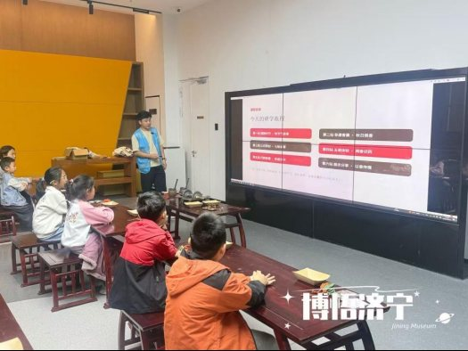
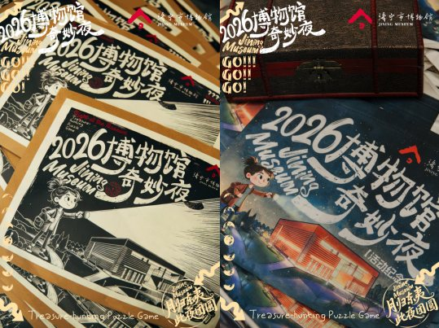

# 济宁市博物馆（朱复戡艺术馆）

> 山东省·济宁市·任城区 · 一级 · 文化文物系统国有博物馆

> 资料馆编号：97a69deba17d40e080dbfc0e6b9fa031

## 文物介绍（图文）

济宁市博物馆（朱复戡艺术馆）位于山东省·济宁市·任城区，为一级文化文物系统国有博物馆。

以下为馆方公开资料中可核实的代表性展品。每件文物单独成节，便于按名称检索和问答；完整文物卡见 `artifacts/` 目录。

### 班子成员

- **类别**：其他
- **馆藏**：济宁市博物馆（朱复戡艺术馆）
- **简介**：济宁市博物馆（朱复戡艺术馆）党委书记、馆长 济宁市博物馆（朱复戡艺术馆）党委副书记 济宁市博物馆（朱复戡艺术馆）党委委员、纪委书记 济宁市博物馆（朱复戡艺术馆）党委委员、副馆长 济宁市博物馆（朱复戡艺术馆）党委委员、副馆长

### 《孔子密码

- **年代**：春秋
- **类别**：青铜器
- **馆藏**：济宁市博物馆（朱复戡艺术馆）
- **简介**：- 4月28日，由孔子博物馆、河南博物院、济宁市博物馆共同主办的“孔子密码——孔子周游列国文物展”在孔子博物馆开幕。展览汇聚了来自山东、河南两省15家文博单位的130余件/套珍贵文物。济宁市博物馆精选40件馆藏珍品参展，包括出土于薛国故城的全国唯一一套保存较完整的春秋时期“书刻工具”，以及代表诸侯级别的青铜重器“七鼎六簋”。 七鼎六簋 展览共分为“问道——起点”“弘道——周游”“承道——归来”三个部分。两千五百多年前，孔子携弟子离开鲁国，开启了长达十四年的“周游列国”之行。他们辗转到达了卫、曹、宋、郑、陈、蔡、楚等国，竭力推行仁礼之道和德政主张。一路上，虽历经艰辛，屡遭碰壁，甚至陷入困境，孔子却始终弘道不辍、弦歌不衰，坚守着“不容然后见君子”的信念。《孔子密码——孔子周游列国文物展》将以器载道，让孔子的精神品格与中华文明的精神基因薪火相传、熠熠生辉。 书刻工具 本次展览免费向公众开放，展期将持续至2026年8月30日。济宁市博物馆诚邀广大观众莅临《孔子密码——孔子周游列国文物展》，循先贤足迹，探文脉源流，于两千五百载弘道征程中感悟圣哲智慧，涵养精神力量。

### 注意事项

- **类别**：织绣
- **馆藏**：济宁市博物馆（朱复戡艺术馆）
- **简介**：作者：管理员 浏览：31728次 1、衣冠不整、醉酒、携带宠物者谢绝入馆。 2、推销各类小商品者，散发广告者谢绝入馆。 3、严禁携带易燃易爆危险品者、管制械具及其他法定危险品者入馆。 4、身高1.2米以下的儿童须由家长带领参观，行动不便的老年人须由亲友陪同参观。 5、观众入馆时，须进行安全检查，请自觉接受安检。 6、观众携带的大件包、袋不得带进展厅，可在存包处免费寄存，贵重物品自行妥善保管。 7、参观车辆禁止在馆区内乱停乱放，到停车场指定位置有序停放。 10、不要随意触摸展品或设备设施，不要损坏公物，不要攀爬躺卧。 11、勿在展区内追逐打闹，推搡拥挤，大声喧哗。 13、展厅内请勿摄像，拍照请勿使用闪光灯。 14、如遇我馆重大或临时性活动，遵从我馆安排。

### 博悟济宁

- **类别**：织绣
- **馆藏**：济宁市博物馆（朱复戡艺术馆）
- **简介**：作者：管理员 浏览：190次 霜落秋阑，草木凝香。济宁市博物馆「霜华凝香・闻香识药」霜降香囊研学圆满收官。一众小小药童齐聚课堂，循着霜降物候，沉浸式探秘中医药非遗，在视听触嗅的体验中，亲手缝制香囊。 课堂拉开序幕，孩子们走进霜降时节，认识霜降三候：豺乃祭兽、草木黄落、蛰虫咸俯，了解秋燥易扰身体的特点，感悟中医“治未病”的养生理念。老师娓娓道来衣冠疗法的千年源流，从先秦纫兰佩香，到代代相传的药囊习俗，揭开香囊这项古老非遗的面纱。 六味本草依次登场，艾叶、薄荷、白芷、藿香、陈皮、菊花，它们各具特质。五感识药挑战趣味开启：细看艾叶茸茸白絮，轻嗅白芷馥郁药香；石臼咚咚捣药，聆听草木碎裂的声响；浅尝温菊花茶，体会药食同源的奥妙。闻香盲盒、触觉摸药的小队对抗赛热闹开赛，小药童们踊跃抢答，现场趣味盎然。 识得本草，方知配伍之道。孩子们初识“君臣佐使”的中医智慧，手持戥子细细称取药材，调配专属香方。填药入囊、收口打结，缀上灵动流苏。把草木芬芳收纳进布袋，一枚枚古朴精巧的香囊就此诞生。 活动尾声，香囊小博览会热闹开启。小药童们高举作品，互相欣赏分享心得。这一方小小香囊，装的不只是本草香气，更是顺应四时的古老生活智慧。 秋霜有韵，本草留芳。愿中医药文化的种子，悄悄埋进少年心底，代代相传。

### 月归东夷・此夜团圆

- **类别**：青铜器
- **馆藏**：济宁市博物馆（朱复戡艺术馆）
- **简介**：作者：管理员 浏览：359次 中秋夜色如纱，当城市白日喧嚣渐渐褪去，夜幕温柔笼罩济宁市博物馆（文化中心馆），展柜里静静陈列的文物不再高冷遥远，在暖柔灯光下，静待一场好玩又烧脑的中秋文博狂欢。 9月25-26日两晚，「月归东夷・此夜团圆」沉浸式解谜研学活动火热上演，近500名名市民化身历史探索者与文物守护者，穿梭于展厅回廊之间，解锁了一场氛围感拉满的中秋实景文博解谜大冒险。 作为济宁市博物馆2026中秋“博物馆奇妙夜”重磅活动，这场活动彻底告别传统博物馆“看展板、听讲解”的枯燥逛展模式！把跌宕有趣的故事剧本搬进真实展厅，把馆藏文物变成解谜线索，将厚重的东夷历史、儒家文化全部拆解成趣味闯关游戏。不再是被动接收知识，而是亲手找线索、破谜题，边逛边玩解锁千年历史，研学直接变身氛围感十足的中秋实景文博探秘体验！ 扣人心弦的剧情故事，在各个展厅徐徐上演。走进“济宁千秋”展厅文明曙光区，不再是走马观花看文物，你要睁大眼睛搜寻蛛丝马迹，顺着谜题指引探秘神秘古老的东夷文明，一枚斑驳古朴的汉代铜镜，说不定就是帮你拨开迷雾的关键密码。 不少亲子家庭收获满满惊喜。一位带娃参与的家长感触颇深：“以往逛博物馆，孩子总觉得文物遥远又枯燥。这次为了搜寻线索，他主动趴在展牌前研读二十多分钟，还追着问我少昊的故事。”好玩有趣的游戏体验，悄悄在孩子心里种下历史的种子。 移步“人文胜迹”展厅，烧脑程度和欢乐氛围直接拉满！

## 历史背景资料

济宁市博物馆（朱复戡艺术馆）的馆址位于山东省·济宁市·任城区。本馆为一级文化文物系统国有博物馆。

馆方记载的建馆时间为 1985-05-18。

济宁市博物馆始建于1985年，是一座集历史、艺术、人文为一体的综合性、多功能、现代化地方博物馆。

济宁市博物馆分成两个馆区，其中济宁市博物馆（古槐路馆）由东、西两部分组成：东部是铁塔寺古建筑群，包含宋代铁塔、明代大雄宝殿、钟楼及僧王祠、汉碑室等建筑，1988年被国务院公布为全国重点文物保护单位；

馆舍建筑面积约 3.5 万 平方米。

## 展厅分布与参观路线

### 展厅与陈列

主展楼常设“济宁记忆展”，分为两个展厅：礼成家国——济宁礼俗风情展着重展示对今天仍有积极、普遍意义的传统文明礼仪；

济宁市博物馆（文化中心馆）陈列展览区，有以反映始祖文化、邹鲁文化、儒家文化、水浒文化为主线的济宁千秋展；

### 参观信息

| 项目 | 内容 |
|---|---|
| 馆址 | 济宁市太白湖新区运河路140号（文化中心馆）、济宁市古槐路38号（古槐路馆） |
| 开放时间 | 每周一全天闭馆（国家法定节假日除外） 5月至9月8:30—18:00（17:00以后停止入馆） 10月至次年4月8:30—17:30（16:30以后停止入馆） |
| 是否免费 | 免费开放 |
| 预约方式 | 电话预约：0537-2205009 公众号预约：济宁市博物馆 |
| 联系电话 | 0537-2205009 |
| 官方网站 | http://www.jiningmuseum.com/ |
| 建筑面积 | 3.5 万 平方米 |
| 展厅面积 | 1 万 平方米 |
| 年参观量 | 90.4 万 人次 |

### 建议参观路线

入口/序厅 → 常设展厅 → 专题展厅 → 临时展览 → 文创商店/出口。

以上为一般参观顺序，实际开放展厅与动线以馆方当日公告为准。

## 书画知识

### 馆方资料中的书画信息

有以展示金石书画大师朱复戡作品的朱复戡艺术馆；

### 地域书画脉络

山东书画可上溯到汉画像石，北宋李成、张择端等也与齐鲁密切相关；高凤翰等人的金石书画和泰山、曲阜碑刻共同构成地方脉络。

### 观赏要点

艺术类展馆适合比较同一题材的不同画法：工笔与写意、水墨与设色、传统卷轴与近现代装裱，差异本身就是观看重点。

在济宁市博物馆（朱复戡艺术馆）参观时，可把展签上的名称、年代、出土地和馆藏信息与展件对照阅读；若遇临时展览，以其主题说明为准。
