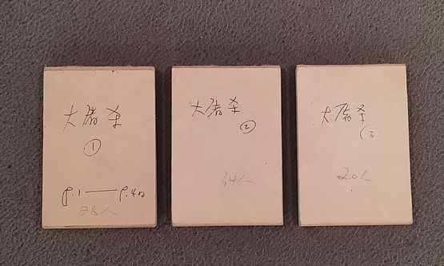
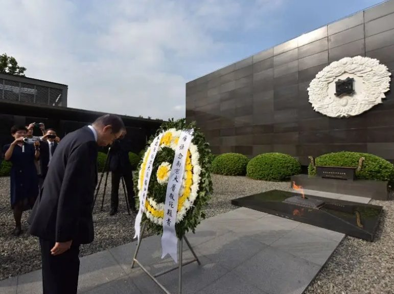

# 侵华日军南京大屠杀遇难同胞纪念馆

> 江苏省·南京市·建邺区 · 一级 · 其他行业国有博物馆

> 资料馆编号：c2f71f8bea3f4acaa903b9e608debbe9

## 文物介绍（图文）

侵华日军南京大屠杀遇难同胞纪念馆位于江苏省·南京市·建邺区，为一级其他行业国有博物馆。馆藏与展陈以“革命纪念”为特色。

以下为馆方公开资料中可核实的代表性展品。每件文物单独成节，便于按名称检索和问答；完整文物卡见 `artifacts/` 目录。

### 江东门“万人坑”遗址

- **年代**：1937年
- **类别**：革命文物
- **馆藏**：侵华日军南京大屠杀遇难同胞纪念馆
- **简介**：南京大屠杀遇难同胞丛葬地遗址，是侵华日军暴行的历史见证。

### 藏品介绍

- **类别**：革命文物
- **馆藏**：侵华日军南京大屠杀遇难同胞纪念馆
- **简介**：联系我们 | 侵华日军南京大屠杀遇难同胞纪念馆 南京市侵华日军受害者援助与南京大屠杀历史记忆传承协会 images/about_hearder.jpg 南京市侵华日军受害者援助与南京大屠杀历史记忆传承协会 南京市侵华日军受害者援助与南京大屠杀历史记忆传承协会 纪念馆共收藏国家珍贵文物6000余件，其中一级文物300余件，藏品的来源包括出土挖掘、民间征集、社会捐赠等。 馆藏文物中最具代表性的藏品有：中山码头集体屠杀遗址出土的南京大屠杀遇难者遗物，美国牧师约翰·马吉拍摄南京大屠杀暴行时使用的摄像机及胶片，南京国防部审判日本战犯军事法庭庭长石美瑜保存的战犯谷寿夫、向井敏明等人的死刑判决书底稿，中国远征军抗战老兵梅树淇1942年的战地日记，以及分馆南京利济巷慰安所旧址陈列馆中陈列的南京福安里慰安所旧址发现的日军对“慰安妇”使用的妇科检查用具等。 1986年徐志耕研究“南京大屠杀”的笔记手札 1979年9月南京大学历史系编著、内部刊印... 1963年11月南京大学历史系日本史小组编... 1972年洞富雄著、日本新人物往来社发行... 1989年藤原彰著、日本岩波书店发行的《... 联系我们 | 侵华日军南京大屠杀遇难同胞纪念馆

### 正义的审判

- **类别**：其他
- **馆藏**：侵华日军南京大屠杀遇难同胞纪念馆
- **简介**：78年前的今天，远东国际军事法庭判处25名日本甲级战犯有罪，其中，判处东条英机、松井石根、广田弘毅等7名甲级战犯绞刑；其余分别处以无期徒刑或有期徒刑。这些战争罪犯分别犯有“反和平罪”“普通战争罪”“反人道罪”等罪名，双手沾满中国人民和亚洲其他国家人民的鲜血，是日本发动侵略战争的元凶和主谋！

### 张纯如逝世22周年

- **类别**：其他
- **馆藏**：侵华日军南京大屠杀遇难同胞纪念馆
- **简介**：联系我们 | 侵华日军南京大屠杀遇难同胞纪念馆 南京市侵华日军受害者援助与南京大屠杀历史记忆传承协会 images/about_hearder.jpg 南京市侵华日军受害者援助与南京大屠杀历史记忆传承协会 南京市侵华日军受害者援助与南京大屠杀历史记忆传承协会 联系我们 | 侵华日军南京大屠杀遇难同胞纪念馆

### 一位正视历史的日本老人走了

- **类别**：其他
- **馆藏**：侵华日军南京大屠杀遇难同胞纪念馆
- **简介**：据日本媒体报道，日本前首相福田康夫近日去世。 福田康夫曾说，中日四个政治文件规定了两国关系遵循的原则，必须时刻牢记，不能走回头路。回想2018年6月24日，正值中日和平友好条约缔结40周年，福田康夫从上海专程驱车来到南京，走进侵华日军南京大屠杀遇难同胞纪念馆，他也是继村山富市、海部俊树、鸠山由纪夫之后，第四位来到本馆参观的日本前首相。 在近两个小时的参观中，福田康夫神情凝重，认真听取讲解，在史料前久久驻足。随后，他来到祭场，向写有“奠”字的祭台献上花圈，白色挽联上写着“沉痛悼念南京大屠杀死难者 日本国原总理大臣福田康夫挽”。福田康夫双手整理挽联，率同行人员长时间默哀，并在冥思厅前挥毫题下“和平东亚”四个字。 参观后福田康夫曾表示：“最痛彻的感受就是战争不可以发生，和平最为可贵。这次参观，让我深感战争是如此的残酷，无辜的民众被裹挟进来，造成了惨痛的伤害。悲剧因战争而产生，人类决不能允许它再次发生。”福田康夫还说：“这是一座很好的纪念馆，通过详实的史料来展现历史，我能感受到馆方为之付出的努力，不少资料在日本国内未曾公开，对于这些，日本人应该要多加了解。” 就在2025年12月13日南京大屠杀死难者国家公祭日，已届九旬的福田康夫接受央视总台专访时仍坚定表示：“历史无法磨灭。今后的日本人，有必要了解这些过去的事，需要探访历史遗址、回望历史。我想，南京的那次参观经历给了我这样的机会。”

## 历史背景资料

侵华日军南京大屠杀遇难同胞纪念馆的馆址位于江苏省·南京市·建邺区。本馆为一级其他行业国有博物馆。

馆方记载的建馆时间为 1985-02-13。

首次对外开放时间为 1985-08-15。

侵华日军南京大屠杀遇难同胞纪念馆建立在南京大屠杀死难者遗骸原址上，于1985年8月15日建成开放，为全国重点文物保护单位、全国爱国主义教育示范基地、国家一级博物馆、海峡两岸交流基地、国防教育基地，入选第一批“国家级抗战纪念设施、遗址名录”。

纪念馆总占地面积10.3万平方米，展陈面积近2万平方米，设有雕塑广场、公祭广场、史料陈列厅、悼念广场、墓地广场、“万人坑”遗址、祭场、冥思厅、和平公园等区域，管理南京利济巷慰安所旧址陈列馆；

馆舍建筑面积约 4 万 平方米。

## 展厅分布与参观路线

### 展厅与陈列

设有基本陈列“南京大屠杀史实展”、主题展览“正义必胜 和平必胜 人民必胜——中国战区反法西斯战争胜利暨审判日本战犯史实展”、“慰安妇”受害者专题陈列“二战中的性奴隶——日军‘慰安妇’制度及其罪行展”，引导公众牢记历史、不忘过去，珍爱和平、开创未来。

纪念馆积极开展国际和平交流活动，累计100多个国家和地区的亿万观众前来参观。

### 官网展览信息

今年是远东国际军事法庭开庭审判日本战犯80周年，为深入传播南京大屠杀的法律定论和国际公论，本次展览展示侵华日军南京大屠杀遇难同胞纪念馆近年来征集或复制的东京审判相关照片、记录、证词、影像等档案文献，重点展出新发现的美国检察官萨顿档案，以及加拿大检察官诺兰档案、中国检察官翻译高文彬口述史等近年来获取的新史料，并集中展示《远东国际军事法庭庭审记录》等一系列最新研究成果。

本次活动面向全球征集，共收到有效参赛作品3322件（组），分别来自全球42个国家和地区，并从中遴选185幅优秀作品展出。

展览从史料、史论、外译三个方面展开叙述，共展出文献实物500多件，其中包括300余件受害方、加害方和第三方的档案文献，170多部南京大屠杀史研究著作，50多部南京大屠杀史料和著作的对外

### 参观信息

| 项目 | 内容 |
|---|---|
| 馆址 | 江苏省南京市水西门大街418号 |
| 开放时间 | 早8:30到17:30，每周一闭馆 |
| 是否免费 | 免费开放 |
| 预约方式 | 预约渠道：微信公众号—侵华日军南京大屠杀遇难同胞纪念馆 |
| 联系电话 | 025-86610931 |
| 官方网站 | http://www.19371213.com.cn |
| 建筑面积 | 4 万 平方米 |
| 展厅面积 | 2.8 万 平方米 |
| 年参观量 | 623.8 万 人次 |

### 建议参观路线

入口/序厅 → 常设展厅 → 专题展厅 → 临时展览 → 文创商店/出口。

以上为一般参观顺序，实际开放展厅与动线以馆方当日公告为准。

## 书画知识

### 书画收藏定位

侵华日军南京大屠杀遇难同胞纪念馆公开资料未将书画列为核心收藏，具体展陈以馆方公告与展厅展签为准。

### 地域书画脉络

江苏书画传统深厚，苏州有吴门四家，南京有金陵八家，扬州有扬州八怪；近现代傅抱石、徐悲鸿等又从不同方向拓展了水墨语言。

### 观赏要点

革命题材书画要结合创作年代与事件背景；版画、宣传画、油画、国画各有材料语言，不能一律套用传统水墨标准。

在侵华日军南京大屠杀遇难同胞纪念馆参观时，可把展签上的名称、年代、出土地和馆藏信息与展件对照阅读；若遇临时展览，以其主题说明为准。
