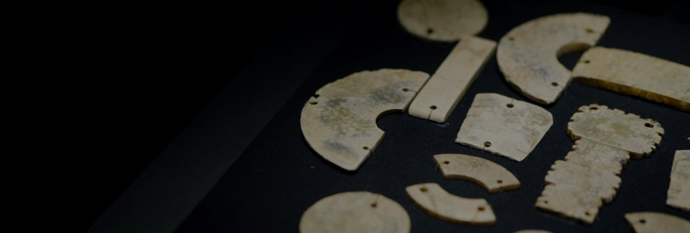

# 徐州博物馆

> 江苏省·徐州市·云龙区 · 一级 · 文化文物系统国有博物馆

> 资料馆编号：e1e1d8d6447442ca84522664c2a518ed

## 文物介绍（图文）

徐州博物馆位于江苏省·徐州市·云龙区，为一级文化文物系统国有博物馆。

以下为馆方公开资料中可核实的代表性展品。每件文物单独成节，便于按名称检索和问答；完整文物卡见 `artifacts/` 目录。

### 金缕玉衣

- **年代**：西汉
- **类别**：玉器
- **馆藏**：徐州博物馆
- **简介**：出土于狮子山楚王陵，以大量玉片和金丝编缀，是汉代楚王陵墓的重要随葬品。

### 西汉S形玉龙

- **年代**：西汉
- **类别**：玉器
- **馆藏**：徐州博物馆
- **简介**：玉龙呈S形，线条流畅，是徐州西汉楚王陵出土玉器中的精品。

### 西汉陶跪坐甲胄俑

- **类别**：陶瓷
- **馆藏**：徐州博物馆
- **简介**：【徐州博物馆】日最大承载量：1万人次 瞬时承载量：0.25万人次 【徐州汉画像石艺术馆】日最大承载量：4000人次 瞬时承载量：800人次 俑头戴风字盔，盔檐垂至双肩，仅露出面部，头盔形制与狮子山楚王墓中出土的铁胄相同。面部的嘴、眼、眉、鼻塑造清晰，形态逼真。陶俑内穿宽袖长襦，外罩短袖齐膝甲，长襦垂地遮足。右手握拳，拳心中空，手中原应持物。左手半握，手中原应持有长兵器。俑身后背有箭箙。这些跽坐甲胄俑头身采用前后合模制成，然后再粘接双臂，俑体两侧留有明显的接痕。这种跽坐甲胄俑从造型特点看，当是车士俑。

### 西汉“飞骑”铭陶骑马俑

- **年代**：西汉
- **类别**：陶瓷
- **馆藏**：徐州博物馆
- **简介**：【徐州博物馆】日最大承载量：1万人次 瞬时承载量：0.25万人次 【徐州汉画像石艺术馆】日最大承载量：4000人次 瞬时承载量：800人次 ◇ 藏品名称：西汉“飞骑”铭陶骑马俑 马腹部刻划“飞骑”二字，史书记载“楚兵剽轻，难于争锋”。“飞骑”二字表现出当时楚国骑兵的骠悍与迅疾。骑俑由马耳、首、身(鞍)、四足、尾以及俑身、双腿等部件组合而成。

### 西汉陶骞袍女舞俑

- **类别**：陶瓷
- **馆藏**：徐州博物馆
- **简介**：【徐州博物馆】日最大承载量：1万人次 瞬时承载量：0.25万人次 【徐州汉画像石艺术馆】日最大承载量：4000人次 瞬时承载量：800人次 俑脑后垂髻，身着右衽曳地长袍，上体前倾，左臂自然垂于体侧，右臂高高上举，双腿微微前曲，右腿略前，左腿稍后，肢体呈S形。俑为头、身分制，颈下端有圆锥形插榫，可插入空洞的体腔内。舞俑原施有彩绘，出土时彩绘鲜明，现已大部剥落。表现的应是当时楚王宫廷舞者的形象。

### 西汉陶抚瑟乐俑

- **类别**：陶瓷
- **馆藏**：徐州博物馆
- **简介**：【徐州博物馆】日最大承载量：1万人次 瞬时承载量：0.25万人次 【徐州汉画像石艺术馆】日最大承载量：4000人次 瞬时承载量：800人次 陶俑头发后挽垂髻，身着右衽曲裾深衣。双膝着地，上身前倾。双臂曲肘前伸，左手作抚弦状，右手作弹拨状。

### 西汉彩绘陶背箭箙俑

- **类别**：陶瓷
- **馆藏**：徐州博物馆
- **简介**：◇ 文物编号：9897、9896、9895、9925 ◇ 藏品尺寸：高50、宽12厘米；高50、宽12厘米；高48、宽13厘米；高50、宽14厘米 北洞山楚王墓共出土背箭箙陶俑64件，均身佩长剑，肩负箭箙。箭箙通过腋下和左肩的三根带子固定，系结于胸前，形成三角形背带，便于背负和奔跑。此类俑虽为弓箭手形象，但有些右胯绶带系墨书“郎中”或“中郎”印，是为楚王近侍。双襟长袍背箭箙俑多放置于较中间的位置，周为曲裾深衣背箭能俑。结合其装备看，这类陶俑的地位要高于曲裾深衣背箭箙俑，应是俑群的指挥者。北洞山楚王墓出土的彩绘仪卫陶俑皆佩有长剑，反映出当时佩剑之风的盛行，印证了《晋书·舆服志》中汉制“自天子至于百官，无不佩剑”的记载。

### 西汉彩绘陶执兵俑

- **年代**：汉代
- **类别**：陶瓷
- **馆藏**：徐州博物馆
- **简介**：◇ 文物编号：9850、9848、9847、9849 ◇ 藏品尺寸：高51、宽13厘米；高50、宽12厘米；高50、宽12厘米；高50、宽12厘米 俑为戴帽执兵陶俑，帽带系结于颌下。面部眉目细长，留有八字胡须。身穿二重右衽曲裾深衣，胸前佩长剑。腰间束带并悬挂组带和绶带。双手半握拳置于右肋，左拳在上，右拳居下，所执兵器为木质长戟，仅剩朽痕。下身穿肥袴，足登双尖翘首履。 北洞山楚王墓出土的彩绘执兵陶俑形式各异的眉、须，五颜六色的服饰，各不相同的剑鞘纹饰和玉具剑，不同的组带、绶带系结形式等等，都超过以往已发现的帛画、壁画、木俑和服饰等，极大地丰富了汉代早期的服饰资料。陶俑的服饰、形制的不同表明其身份亦有差异。相当数量彩绘陶俑所佩绶带下端均有半通印，印文多为郎中，少数为中郎。“郎中”，亦即廊中，指宫廷之廊，战国即有，秦设郎中令，“掌宫廷掖门户”。《汉书·百官公卿表》日：“郎掌守门户，出充车骑，有议郎、中郎、侍郎、郎中。”《后汉书·百官志》亦载：“凡郎官皆主更直执戟，宿卫诸门，出充车骑。”因此，这批彩绘陶俑都应是楚王的宿卫侍从。郎中既可以是武职，亦可以由文士充任：前者如韩信，事项羽时“官不过郎中，位不过执戟”；后者如著名文学家枚乘，诏任郎中未至长安即病死。“中郎”的地位较郎中稍高，未佩郎中印的彩绘俑大概是没有官职的一般执戟卫土。

### 西汉彩绘陶执笏俑

- **类别**：陶瓷
- **馆藏**：徐州博物馆
- **简介**：◇ 文物编号：09835、09836 ◇ 藏品尺寸：高50，宽12厘米；高54、宽15厘米 俑神态庄重，持笏佩剑。头戴帽或着冠，著三重深衣，交领右衽，拱手，衣袖笼罩双手。拱手而立，拱手处有一长方形孔，应为插笏板所用。笏板以竹木制成，已朽，仅有碎木屑残留在孔中。左肋也有一小孔，推测是插剑之处。《礼记·玉藻》：“笏，手板也。(朝臣)有指画于君前，受命于君前，书笏。”《晋书·舆服志》载：“笏者有事则书之，故常簪笔，今之白笔是其遗象。三台五省二品文官簪之，王、公、侯、伯、子、男、卿尹及武官不簪。加内侍卫者乃簪之。”可以看出，这种拱手持笏陶俑应是有较高职位的文官，代表的是楚国有较高官职的文职官员的形象。

### 西汉陶马

- **类别**：陶瓷
- **馆藏**：徐州博物馆
- **简介**：◇ 藏品尺寸：长67、高65、宽20厘米 羊鬼山陪葬坑共出土4匹陶马。这些陶马与狮子山兵马俑坑出土的陶马形制几乎相同，灰色泥质陶制成，均立姿，形制相似，应为两骖两服。陶马形体健壮，额头上的鬃毛呈圆形，双目突出，尖耳直竖，双唇微合，唇后端有一贯穿两侧的圆孔，应为装马衔处。马颈部剪鬃，臀部浑圆，身下部两端各做成椭圆形平台，以便粘接马腿。马尾下垂，梢部挽结。有的马胸前残留有红彩，与狮子山兵马俑坑出土的陶马彩绘一致。整匹马为分模制作：马耳单独模制，头颈用双模制作，身躯也用双模制作，腔壁厚重，下部留口；马四肢模制成型，多为实心体，个别后腿上部中空；马尾亦用模制成实心体。马体各部件烧制后，再进行粘接、涂彩。

### 西汉陶官吏俑

- **类别**：陶瓷
- **馆藏**：徐州博物馆
- **简介**：【徐州博物馆】日最大承载量：1万人次 瞬时承载量：0.25万人次 【徐州汉画像石艺术馆】日最大承载量：4000人次 瞬时承载量：800人次 此俑头戴平顶帻，身著三重深衣，外罩博袖长袍，高领右衽，腰际束带。双手拱于胸前，宽袖遮盖双手，上有一长方形孔，原应持有令笏之类。左肋下亦有一长方形孔，可能原来插有木质长剑之类的兵器。袖部和领部残存有红彩。陶俑身材魁伟高大，其身份应当是官吏俑。

### 西汉陶执兵俑

- **类别**：陶瓷
- **馆藏**：徐州博物馆
- **简介**：【徐州博物馆】日最大承载量：1万人次 瞬时承载量：0.25万人次 【徐州汉画像石艺术馆】日最大承载量：4000人次 瞬时承载量：800人次 俑身着右衽阔袖深衣，腰部系有革带，衣长至脚踝，脚穿齐头靴。右臂下垂，左手，抬起上曲，双手握拳，拳心有孔，应持有器械。俑身上原施有彩绘，出土时已基本脱落。

## 历史背景资料

徐州博物馆的馆址位于江苏省·徐州市·云龙区。本馆为一级文化文物系统国有博物馆。

馆方记载的建馆时间为 1959-04-01。

首次对外开放时间为 1960-08-01。

徐州博物馆始建于1959年4月，1960年8月正式开馆，现加挂徐州汉画像石艺术馆牌子，已建成国家一级博物馆、全国文明单位、全国优秀人文社科普及基地、国家4A级旅游景区、省及徐州市爱国主义教育基地，是徐州市保护、陈列、收藏和研究历史文物的综合性博物馆。

博物馆主馆历经2010年改扩建工程、2018年展陈提升改造工程，已建成由西汉采石场遗址、土山东汉彭城王墓、清乾隆行宫和陈列楼四部分组成，集古遗址、古墓葬、古建筑于一体，国保、省保、市保单位于一身，以汉文化为鲜明特色的地方博物馆。

馆舍建筑面积约 2.8 万 平方米。

## 展厅分布与参观路线

### 展厅与陈列

徐州博物馆始建于1959年4月，1960年8月正式开馆，现加挂徐州汉画像石艺术馆牌子，已建成国家一级博物馆、全国文明单位、全国优秀人文社科普及基地、国家4A级旅游景区、省及徐州市爱国主义教育基地，是徐州市保护、陈列、收藏和研究历史文物的综合性博物馆。

博物馆主馆历经2010年改扩建工程、2018年展陈提升改造工程，已建成由西汉采石场遗址、土山东汉彭城王墓、清乾隆行宫和陈列楼四部分组成，集古遗址、古墓葬、古建筑于一体，国保、省保、市保单位于一身，以汉文化为鲜明特色的地方博物馆。

### 官网展览信息

徐州博物馆主馆基本陈列包括“古彭千秋”“大汉气象”“天工汉玉”“汉家烟火”“俑秀凝华”“金戈铁马”“邓永清收藏书画展”七大展览，展出各类文物珍品五千余件，全面展示了徐州丰富璀璨的历史文化和厚重的地域文明。

徐州汉画像石艺术馆基本陈列为“大汉王朝——石上史诗” 陈列于南馆，展出画像石精品400余块；

“汉石遗珍”陈列于北馆，展出自清末到1989年之间发掘和发现的画像石精品160余块，分别陈列在七个展室和206米的展廊上。

南、北馆的陈列，全面、立体地反映了徐州汉画像石艺术馆在文物收藏、科学研究及陈列艺术方面的成果，使观众能够较全面地了解徐州汉画像石、汉代徐州人的生活。

### 参观信息

| 项目 | 内容 |
|---|---|
| 馆址 | 江苏省徐州市和平路118号 |
| 开放时间 | 周二至周日9:00-17:00，逢周一闭馆（法定节假日和特殊情况除外） |
| 是否免费 | 免费开放 |
| 预约方式 | 1、开放时间：每周二至周日9：00——17：00（16：00停止入馆），周一闭馆（国家法定假日除外）。 2、预约参观：实行网上实名预约制，分三个时段入馆参观。观众可通过徐州博物馆微信公众号或官方网站提前预约，预约成功后，刷身份证或预约二维码入馆。未成年人可由家长代为预约。持有老年证、残疾证、军官证或士官证的观众本人，可无需预约，出示证件直接入馆参观。 |
|
| 官方网站 | http://www.xzmuseum.com |
| 建筑面积 | 2.8 万 平方米 |
| 展厅面积 | 1.3 万 平方米 |
| 年参观量 | 242.7 万 人次 |

### 建议参观路线

入口/序厅 → 常设展厅 → 专题展厅 → 临时展览 → 文创商店/出口。

以上为一般参观顺序，实际开放展厅与动线以馆方当日公告为准。

## 书画知识

### 书画收藏定位

徐州博物馆公开资料未将书画列为核心收藏，具体展陈以馆方公告与展厅展签为准。

### 地域书画脉络

江苏书画传统深厚，苏州有吴门四家，南京有金陵八家，扬州有扬州八怪；近现代傅抱石、徐悲鸿等又从不同方向拓展了水墨语言。

### 观赏要点

历史类展馆中的书画，先读年代、作者、材质和出土/征集信息，再结合题跋、印章判断流传，不要只凭画面风格下结论。

在徐州博物馆参观时，可把展签上的名称、年代、出土地和馆藏信息与展件对照阅读；若遇临时展览，以其主题说明为准。
