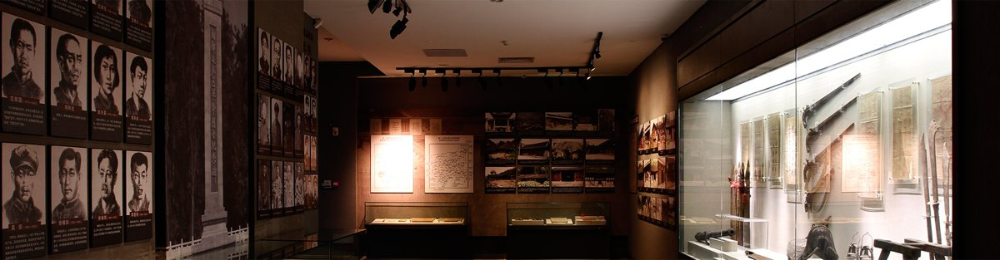

# 恩施土家族苗族自治州博物馆

> 湖北省·恩施土家族苗族自治州·恩施市 · 一级 · 文化文物系统国有博物馆

> 资料馆编号：c2c2906cc8ce4448b0fc9192a652387b

## 文物介绍（图文）

恩施土家族苗族自治州博物馆位于湖北省·恩施土家族苗族自治州·恩施市，为一级文化文物系统国有博物馆。

以下为馆方公开资料中可核实的代表性展品。每件文物单独成节，便于按名称检索和问答；完整文物卡见 `artifacts/` 目录。

### 领导团队

- **类别**：其他
- **馆藏**：恩施土家族苗族自治州博物馆
- **简介**：副馆长：陈利平，女，汉族，1972年6月出生，中共党员，副研究馆员。历任恩施州图书馆副馆长，恩施州民族艺术职业学校副校长等职，2017年10月调入恩施州博物馆任副馆长。负责党建、机关管理、政工人事、财务、档案、陈列展览、文创、工会、妇委会等工作。分管党办、办公室、陈列与设计部。 副馆长：孙喜，男，土家族，1974年4月出生，中共党员，历任恩施州博物馆文物调查勘探办主任、州文化和旅游局驻中坝村第一书记（2017年1月至2020年3月）等职。2019年9月任副馆长，2020年按上级安排驻村开展乡村振兴工作，2023年回馆工作，负责消防、安全保卫、藏品管理、社教接待、考古勘探、信息宣传、学术研究等工作。分管安全保卫部、保管与鉴定部、社教与游客服务中心、勘探部、学术研究部、宣传信息部。

### 东汉青铜双虎钮錞于

- **类别**：书画
- **馆藏**：恩施土家族苗族自治州博物馆
- **简介**：湖北建始景阳革担村二台子农田基本建设时发现，出土于1977年3月。该錞于青铜铸造，器身横截面呈椭圆形，盘较深，唇沿较宽，盘底略凸，饰弦纹，双虎立于盘中，双虎间有一个圆环，便于悬挂。虎身修长，似奔跑状，张口露齿，尾粗壮，末端上卷，整个器物仅盘、钮、虎有纹饰，盘、钮饰刻划纹、草、叶纹、弦纹等，虎前腿刻有船形纹。

### 明代金凤冠饰件

- **类别**：金银器
- **馆藏**：恩施土家族苗族自治州博物馆
- **简介**：1976年在宣恩县猫儿堡施南土司墓地出土。金凤冠冠已不存，仅余29件饰品。这套金凤冠饰品，造型繁复，雍容华贵，做工精细，堪为上品。 主办单位┃恩施土家族苗族自治州博物馆 鄂公网安备42280002000030号 Copyright © 2017 www.bwg.org.cn All Rights Reserved. 地址┃湖北省恩施市金桂大道恩施州文化中心内 办公电话┃0718-8222329 前台接待电话┃0718-8253696 违法和不良信息举报电话：0718-8222329 举报邮箱

### 战国青铜虎钮錞于

- **类别**：青铜器
- **馆藏**：恩施土家族苗族自治州博物馆
- **简介**：该錞于青铜铸造，呈椭圆筒形，上圜下虚，顶部用于悬挂的钮被人为割掉，仅剩下四个虎钮脚痕迹残留于盘中。盘的周长101厘米，缺损掉边长29厘米，器身无纹饰，口平直。完整器物可悬挂，击之而鸣，多用于战争中指挥进退。盘径长35厘米，宽29厘米。

### 清江水布垭出土的商周骨雕器

- **年代**：西周
- **类别**：书画
- **馆藏**：恩施土家族苗族自治州博物馆
- **简介**：兽骨，面微弧，骨片黄白有纹理，表面打磨，厚薄均匀，正面骨片刻成阴线大象头纹，象鼻上卷，圆溜小眼，其造型生动，萌态十足，堪称西周骨雕精品。1998年巴东水布垭发掘出土。 主办单位┃恩施土家族苗族自治州博物馆 鄂公网安备42280002000030号 Copyright © 2017 www.bwg.org.cn All Rights Reserved. 地址┃湖北省恩施市金桂大道恩施州文化中心内 办公电话┃0718-8222329 前台接待电话┃0718-8253696 违法和不良信息举报电话：0718-8222329 举报邮箱

### 西汉铜蒜头壶

- **类别**：青铜器
- **馆藏**：恩施土家族苗族自治州博物馆
- **简介**：主办单位┃恩施土家族苗族自治州博物馆 鄂公网安备42280002000030号 Copyright © 2017 www.bwg.org.cn All Rights Reserved. 地址┃湖北省恩施市金桂大道恩施州文化中心内 办公电话┃0718-8222329 前台接待电话┃0718-8253696 违法和不良信息举报电话：0718-8222329 举报邮箱

### 隋代海马葡萄铜镜

- **类别**：金银器
- **馆藏**：恩施土家族苗族自治州博物馆
- **简介**：主办单位┃恩施土家族苗族自治州博物馆 鄂公网安备42280002000030号 Copyright © 2017 www.bwg.org.cn All Rights Reserved. 地址┃湖北省恩施市金桂大道恩施州文化中心内 办公电话┃0718-8222329 前台接待电话┃0718-8253696 违法和不良信息举报电话：0718-8222329 举报邮箱

### 隋代八菱角纹铜镜

- **类别**：金银器
- **馆藏**：恩施土家族苗族自治州博物馆
- **简介**：主办单位┃恩施土家族苗族自治州博物馆 鄂公网安备42280002000030号 Copyright © 2017 www.bwg.org.cn All Rights Reserved. 地址┃湖北省恩施市金桂大道恩施州文化中心内 办公电话┃0718-8222329 前台接待电话┃0718-8253696 违法和不良信息举报电话：0718-8222329 举报邮箱

### 战国时期铜戈

- **类别**：青铜器
- **馆藏**：恩施土家族苗族自治州博物馆
- **简介**：主办单位┃恩施土家族苗族自治州博物馆 鄂公网安备42280002000030号 Copyright © 2017 www.bwg.org.cn All Rights Reserved. 地址┃湖北省恩施市金桂大道恩施州文化中心内 办公电话┃0718-8222329 前台接待电话┃0718-8253696 违法和不良信息举报电话：0718-8222329 举报邮箱

### 东汉神兽铜镜

- **类别**：金银器
- **馆藏**：恩施土家族苗族自治州博物馆
- **简介**：主办单位┃恩施土家族苗族自治州博物馆 鄂公网安备42280002000030号 Copyright © 2017 www.bwg.org.cn All Rights Reserved. 地址┃湖北省恩施市金桂大道恩施州文化中心内 办公电话┃0718-8222329 前台接待电话┃0718-8253696 违法和不良信息举报电话：0718-8222329 举报邮箱

### 汉代四乳丁鸟纹铭文铜镜

- **类别**：金银器
- **馆藏**：恩施土家族苗族自治州博物馆
- **简介**：主办单位┃恩施土家族苗族自治州博物馆 鄂公网安备42280002000030号 Copyright © 2017 www.bwg.org.cn All Rights Reserved. 地址┃湖北省恩施市金桂大道恩施州文化中心内 办公电话┃0718-8222329 前台接待电话┃0718-8253696 违法和不良信息举报电话：0718-8222329 举报邮箱

## 历史背景资料

恩施土家族苗族自治州博物馆的馆址位于湖北省·恩施土家族苗族自治州·恩施市。本馆为一级文化文物系统国有博物馆。

馆方记载的建馆时间为 1976-10-08。

恩施土家族苗族自治州博物馆（恩施土家族苗族自治州文物调查勘探工作队）1976年成立，馆址位于恩施州文化中心内，是湖北省唯一的地区级综合性少数民族博物馆，是中国博物馆协会少数民族专委会理事单位，湖北省博物馆协会理事单位。

其中，《武陵足音》曾获“全国十大精品陈列优胜奖”，《恩施记忆》曾获“湖北省博物馆、纪念馆六大陈列展览精品奖”，临展《辉煌四十年 奋进新恩施——庆祝恩施土家族苗族自治州建州40周年成就展》获2023年度湖北省博物馆、纪念馆六大陈列展览特别奖。

馆舍建筑面积约 2 万 平方米。

## 展厅分布与参观路线

### 展厅与陈列

恩施州博物馆现有《武陵足音》《恩施记忆》和《生态恩施》3个基本陈列，主要反映巴文化、崖葬文化、土司文化、民族民俗文化以及红色革命文化。

多年来积极加强与省内外博物馆文化交流，引进展览，形成了基本陈列、专题陈列和临时展览互为补充、交相辉映的陈列体系。

其中，《武陵足音》曾获“全国十大精品陈列优胜奖”，《恩施记忆》曾获“湖北省博物馆、纪念馆六大陈列展览精品奖”，临展《辉煌四十年 奋进新恩施——庆祝恩施土家族苗族自治州建州40周年成就展》获2023年度湖北省博物馆、纪念馆六大陈列展览特别奖。

恩施州博物馆先后被命名为湖北省民族团结进步示范单位、湖北省爱国主义教育基地、湖北省中小学环境教育基地、湖北省社科普及基地等，获全省博物馆系统“十佳社教团队”“十佳研学路线”等荣誉。

### 参观信息

| 项目 | 内容 |
|---|---|
| 馆址 | 恩施市金桂大道恩施州文化中心内 |
| 开放时间 | 每周二至周日，周一闭馆（国家法定节假日和特殊情况除外） |
| 是否免费 | 免费开放 |
| 预约方式 | 1、散客凭身份证、驾驶证等有效身份证件入馆参观。 2、团体参观，请提前48小时致电本馆预约，经确认成功后须按约定时间参观。若超时未到馆参观，则预约取消。如遇重大或临时性活动，须遵从本馆安排。预约咨询电话：0718-8253696 |
| 联系电话 | 0718-8222329 |
| 官方网站 | http://www.bwg.org.cn |
| 建筑面积 | 2 万 平方米 |
| 展厅面积 | 5,985 平方米 |
| 年参观量 | 53.9 万 人次 |

### 建议参观路线

入口/序厅 → 常设展厅 → 专题展厅 → 临时展览 → 文创商店/出口。

以上为一般参观顺序，实际开放展厅与动线以馆方当日公告为准。

## 书画知识

### 本馆书画藏品

**东汉青铜双虎钮錞于**：湖北建始景阳革担村二台子农田基本建设时发现，出土于1977年3月。该錞于青铜铸造，器身横截面呈椭圆形，盘较深，唇沿较宽，盘底略凸，饰弦纹，双虎立于盘中，双虎间有一个圆环，便于悬挂。虎身修长，似奔跑状，张口露齿，尾粗壮，末端上卷，整个器物仅盘、钮、虎有纹饰，盘、钮饰刻划纹、草、叶纹、弦纹等，虎前腿刻有船形纹。

**清江水布垭出土的商周骨雕器**（西周）：兽骨，面微弧，骨片黄白有纹理，表面打磨，厚薄均匀，正面骨片刻成阴线大象头纹，象鼻上卷，圆溜小眼，其造型生动，萌态十足，堪称西周骨雕精品。1998年巴东水布垭发掘出土。 主办单位┃恩施土家族苗族自治州博物馆 鄂公网安备42280002000030号 Copyright © 2017 www.bwg.org.cn All Rights Reserved. 地址┃湖北省恩施市金桂大道恩施州文化中心内 办公电话┃0718-8222329 前台接待电话┃0718-8253696 违法和不良信息举报电话：0718-8222329 举报邮箱

### 地域书画脉络

湖北的楚文化留下了帛画、漆画与浪漫奇诡的图像系统；宋代米芾、明代吴伟等与湖北有关，近现代张肇铭等又延续了水墨写生传统。

### 观赏要点

艺术类展馆适合比较同一题材的不同画法：工笔与写意、水墨与设色、传统卷轴与近现代装裱，差异本身就是观看重点。

在恩施土家族苗族自治州博物馆参观时，可把展签上的名称、年代、出土地和馆藏信息与展件对照阅读；若遇临时展览，以其主题说明为准。

## 资料来源

- 国家文物局全国博物馆年度报告（2025 年）
- [恩施土家族苗族自治州博物馆官网](http://www.bwg.org.cn)
- 馆方公开书画藏品资料
