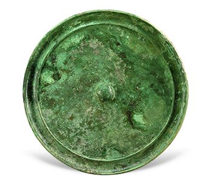
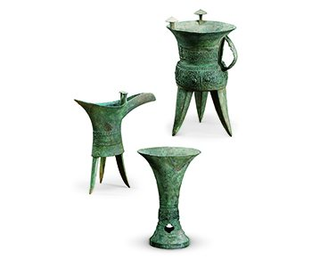
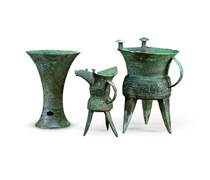
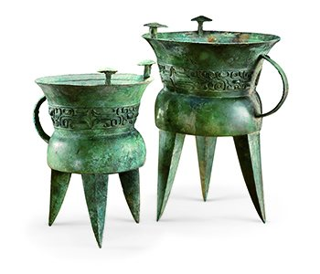
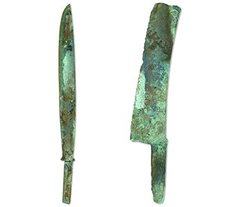

# 湖北省博物馆

> 湖北省·武汉市·武昌区 · 一级 · 文化文物系统国有博物馆

> 资料馆编号：efcbd149cf294a498e574494934dbd5a

## 文物介绍（图文）

湖北省博物馆位于湖北省·武汉市·武昌区，为一级文化文物系统国有博物馆。

以下为馆方公开资料中可核实的代表性展品。每件文物单独成节，便于按名称检索和问答；完整文物卡见 `artifacts/` 目录。

### 越王勾践剑

- **年代**：春秋晚期
- **类别**：青铜器
- **馆藏**：湖北省博物馆
- **简介**：1965年出土于湖北江陵望山一号楚墓，剑身满饰菱形暗纹，历经两千余年仍较锋利，是东周青铜剑的代表。

### 曾侯乙编钟

- **年代**：战国早期
- **类别**：青铜器
- **馆藏**：湖北省博物馆
- **简介**：1978年出土于随州擂鼓墩曾侯乙墓，规模宏大，钟体与钟架保存完整，铭文记录乐律体系，是先秦礼乐文明的重要见证。

### 元青花四爱图梅瓶

- **年代**：元
- **类别**：陶瓷
- **馆藏**：湖北省博物馆
- **简介**：腹部绘王羲之爱兰、陶渊明爱菊、周敦颐爱莲、林和靖爱梅鹤，是元代青花瓷的代表作品。

### 虎座鸟架鼓

- **年代**：战国
- **类别**：其他
- **馆藏**：湖北省博物馆
- **简介**：以虎为座、凤鸟为架，鼓悬其中，造型奇特，体现了楚文化的浪漫想象与漆木工艺水平。

### 铜镜

- **类别**：其他
- **馆藏**：湖北省博物馆
- **简介**：铸制。通体布满绿锈。扁圆体，球形纽，正面微凸，素面。背面微凹，饰一周凸弦纹。

### 铜罍

- **类别**：其他
- **馆藏**：湖北省博物馆
- **简介**：颈、圈足饰凸弦纹，腹部饰三组饕餮纹。饕餮眉做蚕形。圈足有三个“十”字镂孔。

### 铜爵、斝、觚组合

- **类别**：青铜器
- **馆藏**：湖北省博物馆
- **简介**：盘龙城小贵族或平民墓葬也随葬成组的青铜礼器。该青铜爵、斝、觚组合出自杨家湾4号墓。

### 青铜勾刀

- **类别**：青铜器
- **馆藏**：湖北省博物馆
- **简介**：刀身作长条状，双面刃。中部起脊，脊上五穿供捆扎之用。

### 铜铍

- **类别**：青铜器
- **馆藏**：湖北省博物馆
- **简介**：铜铍为刺击形的兵器，似矛，茎部接长柲，不同之在于锋末端有阑。

### 铜觚、爵、斝组合

- **类别**：青铜器
- **馆藏**：湖北省博物馆
- **简介**：杨家湾11号墓是盘龙城遗址晚期墓葬，礼器的组合基本未变。

### 铜斝

- **类别**：青铜器
- **馆藏**：湖北省博物馆
- **简介**：器身饰饕餮纹、夔纹。夔身由二系列云纹构成。斝与爵配合使用，专向爵内注酒，并兼作温酒器。

### 铜锯、铜刀

- **类别**：玉器
- **馆藏**：湖北省博物馆
- **简介**：刀柄玉刀身之间有阑、刀身呈三角尖状。背中脊起棱，上饰贝纹。 锯身作长方形，近柄处略宽，刃部有细齿。

## 历史背景资料

湖北省博物馆的馆址位于湖北省·武汉市·武昌区。本馆为一级文化文物系统国有博物馆。

馆方记载的建馆时间为 1953-03-02。

首次对外开放时间为 1953-06-01。

湖北省博物馆筹备处成立于1953年，1963年定名湖北省博物馆。

1989年湖北省文物考古研究所从湖北省博物馆分出后成立独立机构。

馆舍建筑面积约 12.5 万 平方米。

## 展厅分布与参观路线

### 展厅与陈列

馆内展陈围绕湖北省博物馆的收藏与研究主题展开，设常设展览与临时展览。

### 参观信息

| 项目 | 内容 |
|---|---|
| 馆址 | 湖北省武汉市武昌区东湖路160号 |
| 开放时间 | 周一及除夕闭馆，开馆时间9:00-17:00 |
| 是否免费 | 免费开放 |
| 预约方式 | 一、官方微信公众号 二、官网 |
|
| 官方网站 | http://www.hbww.org.cn |
| 建筑面积 | 12.5 万 平方米 |
| 展厅面积 | 3.8 万 平方米 |
| 年参观量 | 547.1 万 人次 |

### 建议参观路线

入口/序厅 → 常设展厅 → 专题展厅 → 临时展览 → 文创商店/出口。

以上为一般参观顺序，实际开放展厅与动线以馆方当日公告为准。

## 书画知识

### 书画收藏定位

湖北省博物馆公开资料未将书画列为核心收藏，具体展陈以馆方公告与展厅展签为准。

### 地域书画脉络

湖北的楚文化留下了帛画、漆画与浪漫奇诡的图像系统；宋代米芾、明代吴伟等与湖北有关，近现代张肇铭等又延续了水墨写生传统。

### 观赏要点

历史类展馆中的书画，先读年代、作者、材质和出土/征集信息，再结合题跋、印章判断流传，不要只凭画面风格下结论。

在湖北省博物馆参观时，可把展签上的名称、年代、出土地和馆藏信息与展件对照阅读；若遇临时展览，以其主题说明为准。
