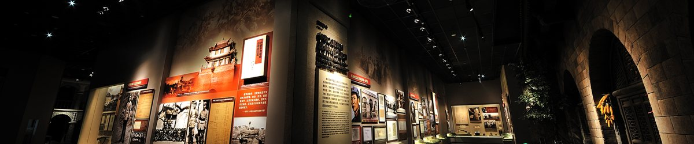

# 韶山毛泽东同志纪念馆

> 湖南省·湘潭市·韶山市 · 一级 · 文化文物系统国有博物馆

> 资料馆编号：049e88d7fc2f4b779fa945c925b7b3c6

## 文物介绍（图文）

韶山毛泽东同志纪念馆位于湖南省·湘潭市·韶山市，为一级文化文物系统国有博物馆。馆藏与展陈以“革命纪念”为特色。

以下为馆方公开资料中可核实的代表性展品。每件文物单独成节，便于按名称检索和问答；完整文物卡见 `artifacts/` 目录。

### 2013年景德镇釉下“乱云飞渡仍从容”瓷板画

- **类别**：陶瓷
- **馆藏**：韶山毛泽东同志纪念馆
- **简介**：

### 20世纪50

- **类别**：其他
- **馆藏**：韶山毛泽东同志纪念馆
- **简介**：

### 1972年毛泽东在中南海游泳池故居接见尼克松、田中角荣、卡翁达时坐过的沙发

- **类别**：其他
- **馆藏**：韶山毛泽东同志纪念馆
- **简介**：

### 2013年景德镇窑釉上“哈达献给毛主席”瓷板画

- **类别**：陶瓷
- **馆藏**：韶山毛泽东同志纪念馆
- **简介**：

### 2013年景德镇窑釉上“战地黄花”瓷板画

- **类别**：陶瓷
- **馆藏**：韶山毛泽东同志纪念馆
- **简介**：

### 20世纪60年代毛泽东头像金属像章

- **类别**：金银器
- **馆藏**：韶山毛泽东同志纪念馆
- **简介**：

### 2013年景德镇窑釉下“毛泽东像”瓷板画

- **类别**：陶瓷
- **馆藏**：韶山毛泽东同志纪念馆
- **简介**：

### 2013年景德镇釉下“韶山毛泽东故居””瓷板画

- **类别**：陶瓷
- **馆藏**：韶山毛泽东同志纪念馆
- **简介**：

### 2013年景德镇釉下“观鱼胜过富春江”瓷板画

- **类别**：陶瓷
- **馆藏**：韶山毛泽东同志纪念馆
- **简介**：

### 2013年景德镇窑釉上“咏梅”瓷板画

- **类别**：陶瓷
- **馆藏**：韶山毛泽东同志纪念馆
- **简介**：

### 2013年景德镇窑釉上“江山如此多娇”瓷板画

- **类别**：陶瓷
- **馆藏**：韶山毛泽东同志纪念馆
- **简介**：

## 历史背景资料

韶山毛泽东同志纪念馆的馆址位于湖南省·湘潭市·韶山市。本馆为一级文化文物系统国有博物馆。

馆方记载的建馆时间为 1964-10-01。

全馆现有在职人员171人，其中正式在编人员101人，合同制人员61人，劳务派遣人员9人；

另有馆属文博公司员工31人，社会化服务人员178人；

退休人员37人。

馆舍建筑面积约 3.3 万 平方米。

## 展厅分布与参观路线

### 展厅与陈列

韶山毛泽东同志纪念馆地处毛泽东主席的诞生地湖南省韶山市韶山冲，原名韶山毛泽东同志旧居陈列馆，于1964年建成对外开放，馆名由邓小平于1983年4月20日题写，是全国唯一一家全面系统展示毛泽东主席生平业绩、思想和人格风范的纪念性专题博物馆。

基本陈列“中国出了个毛泽东”以毛泽东人生经历为主线，采用编年和专题结合的形式，紧紧围绕毛泽东的业绩，重点展示毛泽东经历或决策的重大历史事件的背景、经过、影响，并展现其思想、方法和人格风范。

### 官网展览信息

03-25 《中国出了个毛泽东》虚拟展厅

01-03 《风范长存----毛主席遗物展》VR全景虚拟展厅

### 参观信息

| 项目 | 内容 |
|---|---|
| 馆址 | 湖南省湘潭市韶山市韶山冲 |
| 开放时间 | 一、开放时间 毛泽东同志故居：08:00-16:00，分为外景参观与内景参观，外景无需预约，内景需预约排队； 生平展区：09:00-16:00，周一闭馆维护，逢国家法定节假日顺延； 专题展区：09:00-16:00。 二、“我的韶山行”研学专用时段请以官方公众号公告为准。 |
| 是否免费 | 免费开放 |
| 预约方式 | 韶山毛泽东同志纪念馆免费实名预约参观，未授权第三方平台。个人可关注 “韶山毛泽东同志纪念馆” 官方微信公众号，选 “官方订票” 提前 6 天预约（不含当天），无票可预约候补（限微信端）。团队长期预约可登录官网www.ssmzd.com注册或现场办理。 |
|
| 官方网站 | https://www.ssmzd.com |
| 建筑面积 | 3.3 万 平方米 |
| 展厅面积 | 1.2 万 平方米 |
| 年参观量 | 980.1 万 人次 |

### 建议参观路线

入口/序厅 → 常设展厅 → 专题展厅 → 临时展览 → 文创商店/出口。

以上为一般参观顺序，实际开放展厅与动线以馆方当日公告为准。

## 书画知识

### 书画收藏定位

韶山毛泽东同志纪念馆公开资料未将书画列为核心收藏，具体展陈以馆方公告与展厅展签为准。

### 地域书画脉络

湖南有楚汉帛画、马王堆漆画等重要早期绘画遗存；近现代齐白石、黄永玉等从湘潭、凤凰走向全国，题材多带乡土与民间趣味。

### 观赏要点

革命题材书画要结合创作年代与事件背景；版画、宣传画、油画、国画各有材料语言，不能一律套用传统水墨标准。

在韶山毛泽东同志纪念馆参观时，可把展签上的名称、年代、出土地和馆藏信息与展件对照阅读；若遇临时展览，以其主题说明为准。
