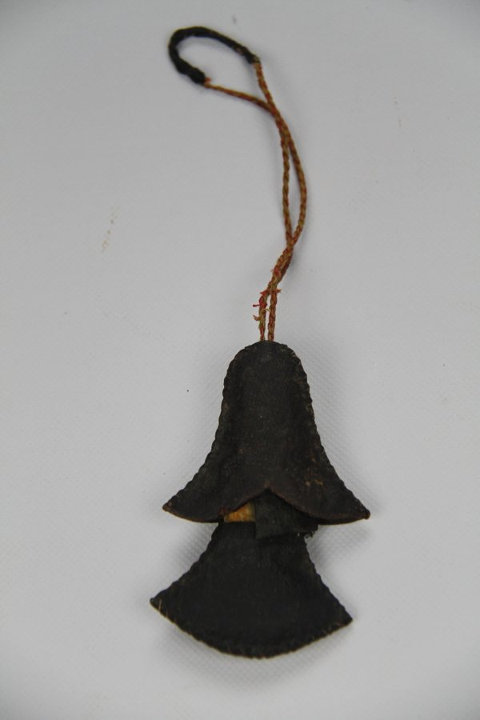
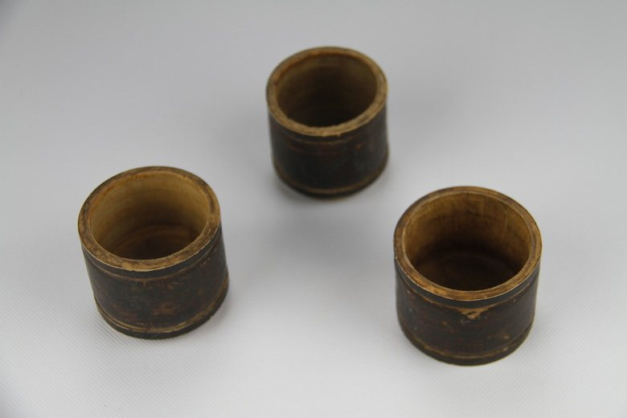
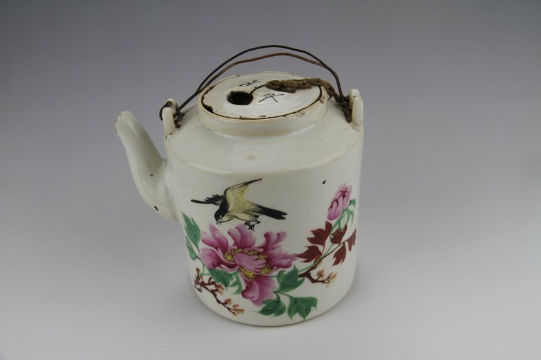
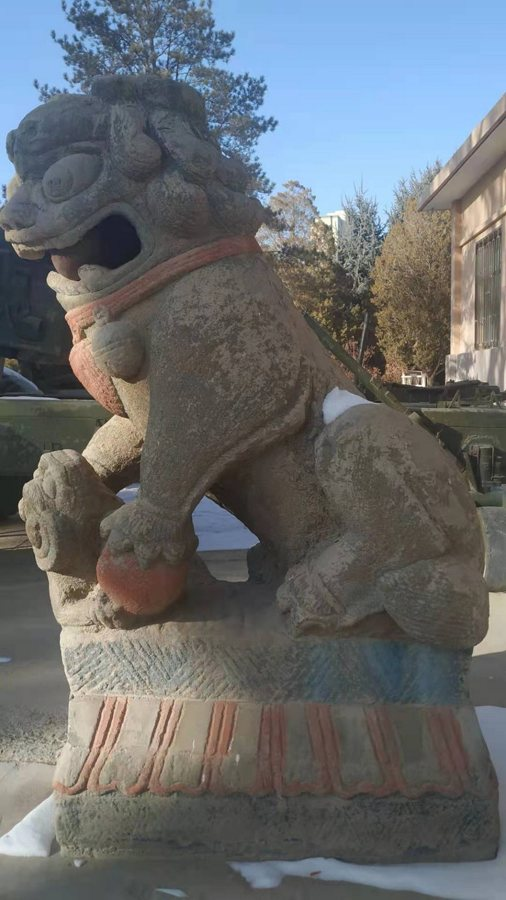
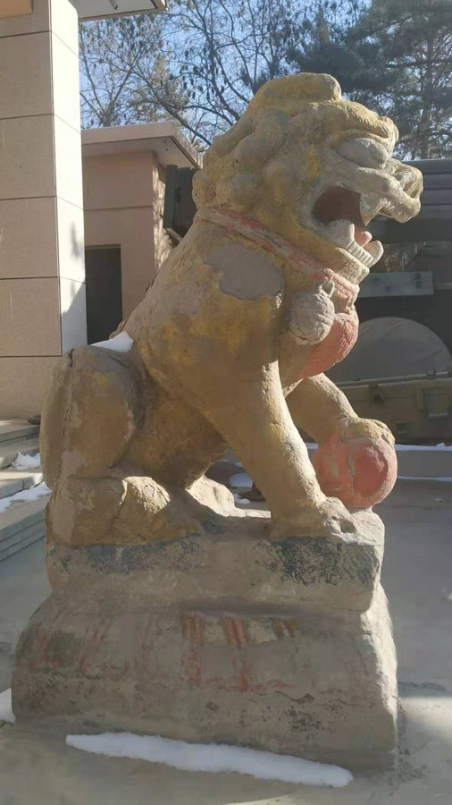

# 中国工农红军西路军纪念馆

> 甘肃省·张掖市·高台县 · 一级 · 其他行业国有博物馆

> 资料馆编号：247702952ddd4a57b1942a65a35efc41

## 文物介绍（图文）

中国工农红军西路军纪念馆位于甘肃省·张掖市·高台县，为一级其他行业国有博物馆。馆藏与展陈以“革命纪念”为特色。

以下为馆方公开资料中可核实的代表性展品。每件文物单独成节，便于按名称检索和问答；完整文物卡见 `artifacts/` 目录。

### 西路军纪念馆志愿讲解员报名表

- **类别**：其他
- **馆藏**：中国工农红军西路军纪念馆
- **简介**：公安备案号：甘公网安备62072402000187号联系电话：0936-6621048 0936-6622136

### 西路军纪念馆小小讲解员报名表

- **类别**：其他
- **馆藏**：中国工农红军西路军纪念馆
- **简介**：公安备案号：甘公网安备62072402000187号联系电话：0936-6621048 0936-6622136

### 子弹

- **类别**：其他
- **馆藏**：中国工农红军西路军纪念馆
- **简介**：公安备案号：甘公网安备62072402000187号联系电话：0936-6621048 0936-6622136

### 针线包

- **类别**：其他
- **馆藏**：中国工农红军西路军纪念馆
- **简介**：公安备案号：甘公网安备62072402000187号联系电话：0936-6621048 0936-6622136

### 雨伞

- **类别**：其他
- **馆藏**：中国工农红军西路军纪念馆
- **简介**：公安备案号：甘公网安备62072402000187号联系电话：0936-6621048 0936-6622136

### 药品盒

- **类别**：其他
- **馆藏**：中国工农红军西路军纪念馆
- **简介**：公安备案号：甘公网安备62072402000187号联系电话：0936-6621048 0936-6622136

### 药罐

- **类别**：其他
- **馆藏**：中国工农红军西路军纪念馆
- **简介**：公安备案号：甘公网安备62072402000187号联系电话：0936-6621048 0936-6622136

### 水壶

- **类别**：青铜器
- **馆藏**：中国工农红军西路军纪念馆
- **简介**：公安备案号：甘公网安备62072402000187号联系电话：0936-6621048 0936-6622136

### 手雷

- **类别**：其他
- **馆藏**：中国工农红军西路军纪念馆
- **简介**：公安备案号：甘公网安备62072402000187号联系电话：0936-6621048 0936-6622136

### 石狮子（母）

- **类别**：其他
- **馆藏**：中国工农红军西路军纪念馆
- **简介**：公安备案号：甘公网安备62072402000187号联系电话：0936-6621048 0936-6622136

### 石狮子（公）

- **类别**：其他
- **馆藏**：中国工农红军西路军纪念馆
- **简介**：公安备案号：甘公网安备62072402000187号联系电话：0936-6621048 0936-6622136

### 趴钉

- **类别**：其他
- **馆藏**：中国工农红军西路军纪念馆
- **简介**：公安备案号：甘公网安备62072402000187号联系电话：0936-6621048 0936-6622136

## 历史背景资料

中国工农红军西路军纪念馆的馆址位于甘肃省·张掖市·高台县。本馆为一级其他行业国有博物馆。

馆方记载的建馆时间为 1957-02-01。

中国工农红军西路军纪念馆前身为高台红西路军烈士陵园，园内掩埋着红西路军转战河西、血战高台壮烈牺牲的红五军军长董振堂、政治部主任杨克明等近3000名革命先烈的忠骨。

2009年，高台烈士陵园正式更名为中国工农红军西路军纪念馆。

馆舍建筑面积约 2.5 万 平方米。

## 展厅分布与参观路线

### 展厅与陈列

有两个基本陈列，陈展主题分别为：理想高于天·热血铸祁连；

### 参观信息

| 项目 | 内容 |
|---|---|
| 馆址 | 甘肃省张掖市高台县城关镇医院西路社区东环路178号 |
| 开放时间 | 每周二至周日上午8：30开馆，下午18：00闭馆。每周一闭馆（国家法定节假日除外。）国 |
| 是否免费 | 免费开放 |
| 预约方式 | 中国工农红军西路军纪念馆预约参观方式为电话预约和微信公众号预约。预约电话：0936—6621048；也可关注微信公众号“中国工农红军西路军纪念馆”进行预约。 |
| 联系电话 | 0936-6622136 |
| 官方网站 | http://www.xljjng.cn/ |
| 建筑面积 | 2.5 万 平方米 |
| 展厅面积 | 7,789 平方米 |
| 年参观量 | 112 万 人次 |

### 建议参观路线

入口/序厅 → 常设展厅 → 专题展厅 → 临时展览 → 文创商店/出口。

以上为一般参观顺序，实际开放展厅与动线以馆方当日公告为准。

## 书画知识

### 书画收藏定位

中国工农红军西路军纪念馆公开资料未将书画列为核心收藏，具体展陈以馆方公告与展厅展签为准。

### 地域书画脉络

甘肃的敦煌壁画、麦积山造像与简牍书法构成丝路艺术长廊；观看壁画要注意线描、矿物色与经变叙事的结合，不能只看单幅画面。

### 观赏要点

革命题材书画要结合创作年代与事件背景；版画、宣传画、油画、国画各有材料语言，不能一律套用传统水墨标准。

在中国工农红军西路军纪念馆参观时，可把展签上的名称、年代、出土地和馆藏信息与展件对照阅读；若遇临时展览，以其主题说明为准。

## 资料来源

- 国家文物局全国博物馆年度报告（2025 年）
- [中国工农红军西路军纪念馆官网](http://www.xljjng.cn/)
- [官网采集页面](http://www.xljjng.cn/)
