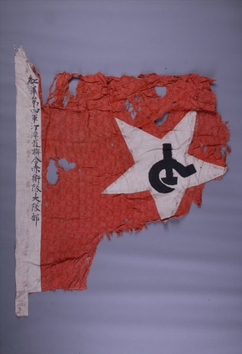
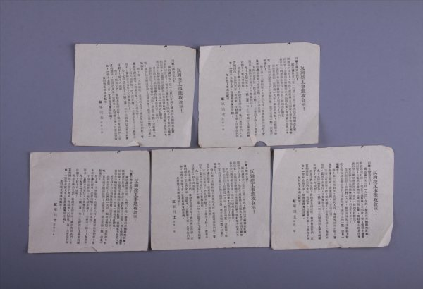
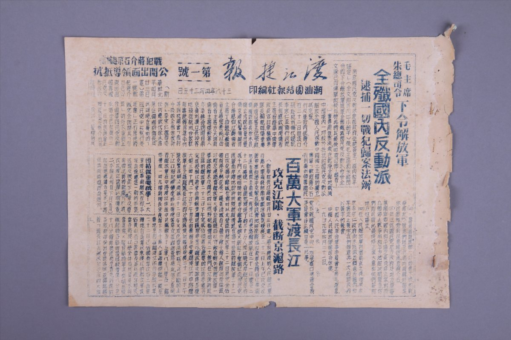
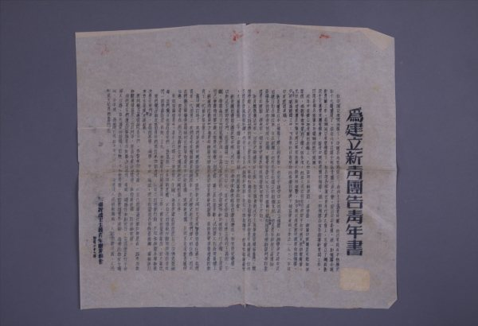

# 古田会议纪念馆

> 福建省·龙岩市·上杭县 · 一级 · 文化文物系统国有博物馆

> 资料馆编号：2c8af2e44d464a459e40ccaa518a8a16

## 文物介绍（图文）

古田会议纪念馆位于福建省·龙岩市·上杭县，为一级文化文物系统国有博物馆。馆藏与展陈以“革命纪念”为特色。

以下为馆方公开资料中可核实的代表性展品。每件文物单独成节，便于按名称检索和问答；完整文物卡见 `artifacts/` 目录。

### 您不知道的古田往事（1949

- **类别**：其他
- **馆藏**：古田会议纪念馆
- **简介**：2019年，古田会议90周年暨古田全军政工会5周年，古田会议纪念馆建馆55周年。

### 1930年11月24日第十乡文委会写给陈一凡要求拨教育经费的信

- **类别**：其他
- **馆藏**：古田会议纪念馆
- **简介**：1930年11月24日第十乡文委会写给陈一凡要求拨教育经费的信 年代：1930年11月24日 质地：纸

### 第二次国内革命战争时期红军第四军汀漳龙联合赤卫队大队部红色花绸布队旗

- **类别**：革命文物
- **馆藏**：古田会议纪念馆
- **简介**：第二次国内革命战争时期红军第四军汀漳龙联合赤卫队大队部红色花绸布队旗 年代：第二次国内革命战争时期（1927-1937） 质地：棉麻纤维

### 1934年3月1日红军战士印发的告白军士兵兄弟书

- **类别**：革命文物
- **馆藏**：古田会议纪念馆
- **简介**：1934年3月1日红军战士印发的告白军士兵兄弟书——《反对挖工事进攻红军》 年代：第二次国内革命战争时期（1927-1937） 质地：纸

### 抗日战争时期永定“抗日巡回剧团”用的手提琴（附盒）

- **类别**：金银器
- **馆藏**：古田会议纪念馆
- **简介**：年代：抗日战争时期（1937-1945） 质地：木,其他金属 级别：三级

### 抗日战争时期陆军新编第四军政治司令部印《本军出征将士家属优待请求书》

- **类别**：其他
- **馆藏**：古田会议纪念馆
- **简介**：抗日战争时期陆军新编第四军政治司令部印《本军出征将士家属优待请求书》 年代：抗日战争时期（1937-1945） 质地：纸

### 1938年8月17日黄告用的新四军出征抗敌军人家属救济请求书

- **类别**：其他
- **馆藏**：古田会议纪念馆
- **简介**：1938年8月17日黄告用的新四军出征抗敌军人家属救济请求书 年代：1938年8月17日 质地：纸

### 抗日战争时期吴裕昌给陈福明的信

- **类别**：其他
- **馆藏**：古田会议纪念馆
- **简介**：年代：抗日战争时期（1937-1945） 质地：纸

### 民国三十八年四月二十五日潮汕团结报社编印第一号《渡江捷报》

- **类别**：其他
- **馆藏**：古田会议纪念馆
- **简介**：地址：福建省龙岩市上杭县古田镇古田路85号 电话：0597-3641143 业务联系电话：0597-3641143 闽公网安备 35082302000102号 中文域名：古田会议纪念馆.公益

### 解放战争时期潮汕新民主主义青年团筹备会发布《为建立新青团告青年书》

- **类别**：其他
- **馆藏**：古田会议纪念馆
- **简介**：解放战争时期潮汕新民主主义青年团筹备会发布《为建立新青团告青年书》 年代：解放战争时期（1945-1949） 质地：纸 级别：三级

### 明哥釉印花瓷盘

- **类别**：陶瓷
- **馆藏**：古田会议纪念馆
- **简介**：地址：福建省龙岩市上杭县古田镇古田路85号 电话：0597-3641143 业务联系电话：0597-3641143 闽公网安备 35082302000102号 中文域名：古田会议纪念馆.公益

## 历史背景资料

古田会议纪念馆的馆址位于福建省·龙岩市·上杭县。本馆为一级文化文物系统国有博物馆。

馆方记载的建馆时间为 1964-03-01。

首次对外开放时间为 1965-12-01。

古田会议纪念馆成立于1964年，是龙岩市人民政府直属的正处级参公事业单位，是国家一级博物馆，是以古田会议会址为依托建立的全面介绍古田会议历史和宣传古田会议精神，集文物收藏管理、红色文化研究、革命旧址修缮保护、宣传教育展示为一体的专题革命纪念馆。

古田会议纪念馆管辖着13处文物保护单位和1座陈列馆，其中全国重点文物保护单位5处（古田会议会址、中共红四军前委机关暨红四军政治部旧址松荫堂、红四军司令部旧址中兴堂、毛泽东《星星之火，可以燎原》写作旧址协成店、中共闽西第一次代表大会会址文昌阁），省级文物保护单位8处（中共闽西特委机关旧址树槐堂、中共闽西特委培训班旧址鸿玉堂、苏家坡圳背岩洞（主席洞）、红军哨所旧址文光阁、红四军军医处旧址吉兴堂、红四军士兵委员会旧址毓公祠、红四军后勤工作部门旧址笃厚堂、红军桥），建筑面积约1.3万平方米，占地面积约8.6万平方米。

馆舍建筑面积约 1.3 万 平方米。

## 展厅分布与参观路线

### 展厅与陈列

馆内展陈以“革命纪念”为主题，通常由常设展览与临时展览两部分组成。

### 参观信息

| 项目 | 内容 |
|---|---|
| 馆址 | 福建省龙岩市上杭县古田镇古田路85号 |
| 开放时间 | 6月至9月：8:00-18:00；其他月份：8:00-17:30；节假日正常开放 |
| 是否免费 | 免费开放 |
| 预约方式 | 预约渠道：0597-3609366（游客服务中心），0597-3641143（办公室） |
| 联系电话 | 0597-3641143 |
| 官方网站 | http://www.gthyjng.cn |
| 建筑面积 | 1.3 万 平方米 |
| 展厅面积 | 1,502 平方米 |
| 年参观量 | 102.3 万 人次 |

### 建议参观路线

入口/序厅 → 常设展厅 → 专题展厅 → 临时展览 → 文创商店/出口。

以上为一般参观顺序，实际开放展厅与动线以馆方当日公告为准。

## 书画知识

### 书画收藏定位

古田会议纪念馆公开资料未将书画列为核心收藏，具体展陈以馆方公告与展厅展签为准。

### 地域书画脉络

福建书画以闽派人物、花鸟见长，黄慎、华嵒等扬州画派名家出自闽地；漆画、德化瓷塑和木版年画又提供了跨媒介的观看角度。

### 观赏要点

革命题材书画要结合创作年代与事件背景；版画、宣传画、油画、国画各有材料语言，不能一律套用传统水墨标准。

在古田会议纪念馆参观时，可把展签上的名称、年代、出土地和馆藏信息与展件对照阅读；若遇临时展览，以其主题说明为准。
