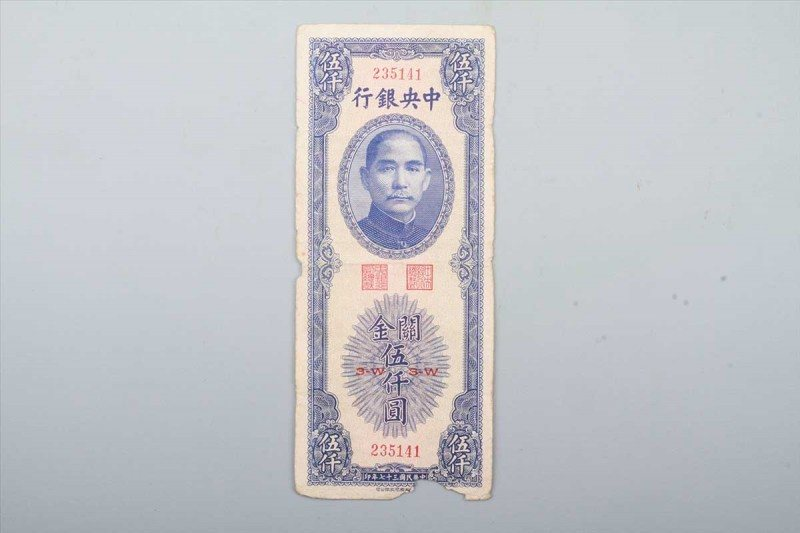
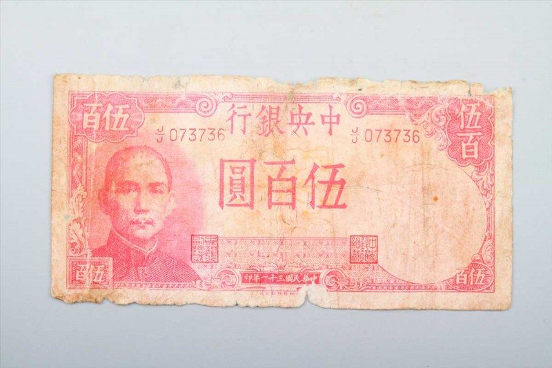
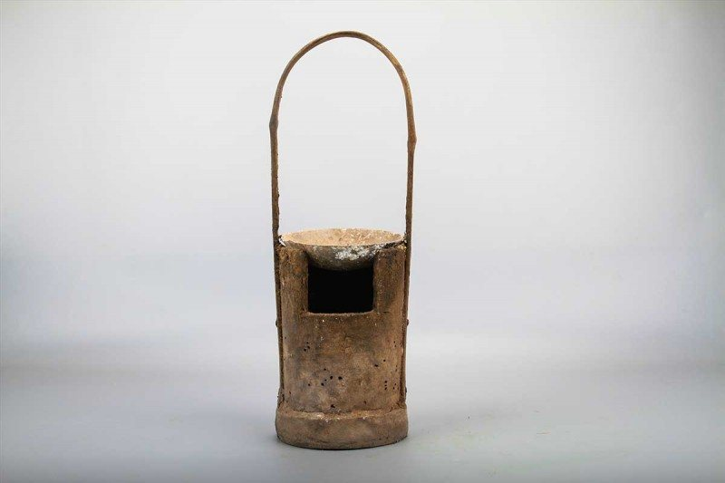
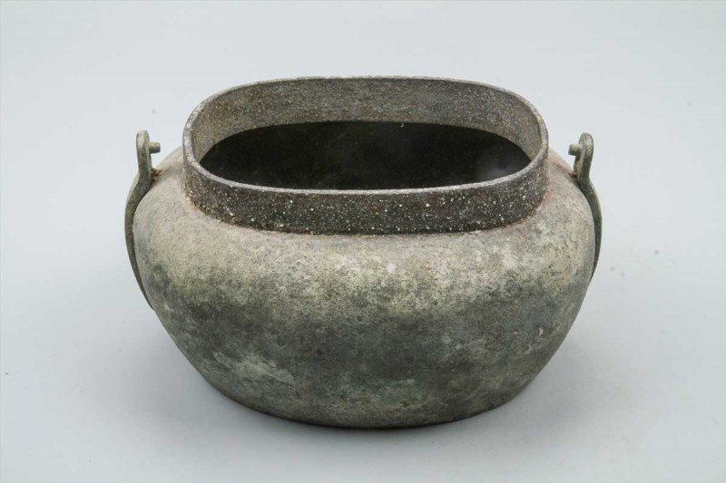

# 四渡赤水纪念馆

> 贵州省·遵义市·习水县 · 一级 · 文化文物系统国有博物馆

> 资料馆编号：10367aa4010946188ad11602609e58ff

## 文物介绍（图文）

四渡赤水纪念馆位于贵州省·遵义市·习水县，为一级文化文物系统国有博物馆。馆藏与展陈以“革命纪念”为特色。

以下为馆方公开资料中可核实的代表性展品。每件文物单独成节，便于按名称检索和问答；完整文物卡见 `artifacts/` 目录。

### 文物故事

- **类别**：金银器
- **馆藏**：四渡赤水纪念馆
- **简介**：- 红军送给张南薰的《区乡苏维埃怎样工作》 微信扫描二维码聆听有声音讲解赤水河畔播火种-----红军送给张南薰的《区乡苏维埃怎样工作》《区乡苏维埃怎样工作》一书，是1934年毛泽东同志编写的《乡苏维埃怎样工作》和张闻天同志编写的《区苏维埃怎样工作》合编本，1934年由中华苏维埃共和国人民委员会出版。这本《区乡苏维埃怎样工作》历经80多年沧桑，书籍页面发黄，封面和极少部份内容缺失，大部分内容完整，是红军长征从瑞金带到贵州习水县，传世不多的极为 发布了解详细 > - 红军手雷青杠坡战斗的见证 经考证这个红军手雷，就是1935年1月中央红军在青杠坡与国民党军激战时，驻扎在五星村屋基坝的红五军团遗留下来的，它见证了青杠坡那场激烈的战斗。 发布了解详细 > - 红军损坏坛子赔的铜板 赵老汉捧着两块铜板，对儿子说：“这是仁义的队伍呀，奇志，要认得他们，以后还给他们开门，奇志，去拿篾条来，咱父子俩把这个坛子框起来，破坛子咱也要，不要丢了，这是个念想。” 发布了解详细 > - 老红军宋加通的革命生涯回忆录 宋加通从一名红军战士的视角和记忆记录下的红军历史，由于间隔了五十年，其中有的地方记录不清楚或是模糊，有的时间和数据和历史的记载有出入，但记录的事件是真实可靠的…… 发布了解详细 > - 红军买药的中华苏维埃纸币重回土城 这几张破旧、泛黄的苏维埃币，给人一种历史沉淀的厚重感，80多年过去了，它记录

### SDCS201603214

- **类别**：其他
- **馆藏**：四渡赤水纪念馆
- **简介**：SDCS201603214—粮管所农村粮食供应凭单贰拾伍公斤

### 《陈云出川》

- **类别**：其他
- **馆藏**：四渡赤水纪念馆
- **简介**：SDCS20157840——陈云出川，2015，长12.7，宽18.8，高0.7，重100

### 《长征回忆录》

- **类别**：其他
- **馆藏**：四渡赤水纪念馆
- **简介**：SDCS20123270—1977年 长征回忆录，长20.2cm，宽14cm，高0.9cm，重150g

### 刺刀

- **类别**：革命文物
- **馆藏**：四渡赤水纪念馆
- **简介**：这把刺刀是红军四渡赤水战役驻扎习水期间遗留下来的。

### 民国时期中央银行发行的关金卷五千元

- **类别**：书画
- **馆藏**：四渡赤水纪念馆
- **简介**：藏品编号：QB5002007129 藏品名称：民国时期中央银行发行的关金卷五千元

### 民国时期中央银行发行的法币伍佰元

- **类别**：金银器
- **馆藏**：四渡赤水纪念馆
- **简介**：藏品编号：QB5002007127 藏品名称：民国时期中央银行发行的法币伍佰元

### 红军长征期间使用的高提梁陶盏竹油灯

- **类别**：陶瓷
- **馆藏**：四渡赤水纪念馆
- **简介**：藏品编号：MQ6002007008 藏品名称：红军长征期间使用的高提梁陶盏竹油灯

### 红军长征期间使用的木撮瓢

- **类别**：革命文物
- **馆藏**：四渡赤水纪念馆
- **简介**：藏品编号：MQ6002007007 藏品名称：红军长征期间使用的木撮瓢

### 长征期间红军使用的小铜称

- **类别**：革命文物
- **馆藏**：四渡赤水纪念馆
- **简介**：藏品编号：JS7002007048 藏品名称：长征期间红军使用的小铜称

### 清末白铜无提手无盖的铜手暖炉

- **类别**：其他
- **馆藏**：四渡赤水纪念馆
- **简介**：藏品编号：JS7002007047 藏品名称：清末白铜无提手无盖的铜手暖炉

## 历史背景资料

四渡赤水纪念馆的馆址位于贵州省·遵义市·习水县。本馆为一级文化文物系统国有博物馆。

馆方记载的建馆时间为 2006-01-09。

首次对外开放时间为 2007-07-09。

四渡赤水纪念馆是经中共中央办公厅批准建设，以纪念中央红军长征四渡赤水战役为主题的历史类博物馆，于2007年7月9日建成开馆，2009年7月起免费对外开放，2020年12月晋升为国家一级博物馆，坐落在贵州省习水县土城古镇，由中央军委原副主席张震将军题写馆名。

展馆运用雕塑、油画、图片、文字、实物相结合的方式，采用声、光、电等技术手段，生动再现了毛泽东及其战友率领中央红军3万余人四次飞渡赤水河，摆脱国民党40万大军的围追堵截，实现战略转移伟大胜利的历史画面，以全新的理念诠释了毛泽东军事生涯的得意之笔。

四渡赤水纪念馆目前已是全国爱国主义教育示范基地、国家国防教育示范基地、全国青少年教育基地、全国妇女爱国主义教育基地、中央国家机关爱国主义教育基地。

馆舍建筑面积约 7,710 平方米。

## 展厅分布与参观路线

### 展厅与陈列

馆内展陈以“革命纪念”为主题，通常由常设展览与临时展览两部分组成。

### 参观信息

| 项目 | 内容 |
|---|---|
| 馆址 | 贵州省遵义市习水县土城镇长征街 |
| 开放时间 | 9:00至17:00 |
| 是否免费 | 免费开放 |
| 预约方式 | 游客一是可通过四渡赤水纪念馆微信公众号等方式预约参观；二是可拨打游客服务中心座机0851-22661923进行预约参观。 |
|
| 官方网站 | http://www.sdcs1935.com |
| 建筑面积 | 7,710 平方米 |
| 展厅面积 | 4,289 平方米 |
| 年参观量 | 17.6 万 人次 |

### 建议参观路线

入口/序厅 → 常设展厅 → 专题展厅 → 临时展览 → 文创商店/出口。

以上为一般参观顺序，实际开放展厅与动线以馆方当日公告为准。

## 书画知识

### 本馆书画藏品

**民国时期中央银行发行的关金卷五千元**：藏品编号：QB5002007129 藏品名称：民国时期中央银行发行的关金卷五千元

### 地域书画脉络

贵州的书画观看宜结合苗族蜡染、侗族刺绣、屯堡地戏面具等民间图像，理解图案的对称、重复与叙事功能，而不只以文人画标准衡量。

### 观赏要点

艺术类展馆适合比较同一题材的不同画法：工笔与写意、水墨与设色、传统卷轴与近现代装裱，差异本身就是观看重点。

在四渡赤水纪念馆参观时，可把展签上的名称、年代、出土地和馆藏信息与展件对照阅读；若遇临时展览，以其主题说明为准。
