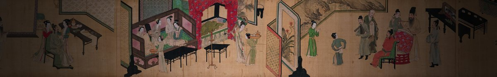

# 重庆中国三峡博物馆（重庆博物馆）

> 重庆市·渝中区 · 一级 · 文化文物系统国有博物馆

> 资料馆编号：c2e29f1c443a4719b1c3d8a56287542f

## 文物介绍（图文）

重庆中国三峡博物馆（重庆博物馆）位于重庆市·渝中区，为一级文化文物系统国有博物馆。

以下为馆方公开资料中可核实的代表性展品。每件文物单独成节，便于按名称检索和问答；完整文物卡见 `artifacts/` 目录。

### 乌杨汉阙

- **年代**：东汉
- **类别**：其他
- **馆藏**：重庆中国三峡博物馆（重庆博物馆）
- **简介**：出土于忠县乌杨镇，石阙保存较多构件，是研究汉代阙制、建筑与雕刻的重要实物。

### 白鹤梁题刻

- **年代**：唐至清
- **类别**：其他
- **馆藏**：重庆中国三峡博物馆（重庆博物馆）
- **简介**：位于涪陵长江江心石梁上，记录历代水文与题刻，是研究长江水文变化的重要资料。

### 龙骨坡的故事

- **类别**：青铜器
- **馆藏**：重庆中国三峡博物馆（重庆博物馆）
- **简介**：展览名称：龙骨坡的故事——“巫山人”考古探秘 展出-2027年1月3日 展出地点：重庆中国三峡博物馆四楼临时展厅D 这个问题是否曾在某个时刻掠过你的意识，像风穿过峡谷，留下空旷回响？ 还有人——比如考古工作者——把它交给石头和泥土。 1985年，一段带有两颗牙齿的疑似人类下颌骨化石（“巫山人”）在重庆巫山龙骨坡遗址被发现，遗址测年超过两百万年。在“早期人类是从约两百万年前的非洲走出并扩散到全世界”的学界共识下，这一发现让我们不由得追问： 带着这样的疑问，一代代考古工作者接续探索四十余年，路上有时遇见微弱的光亮，有时候只触摸到时间冰凉的背脊。但谜题尚未解开，探索就仍在继续。 展览回溯20世纪以来早期人类起源的中外探索历程，从周口店、盐井沟的早期科考，到非洲古人类化石的重大发现，铺陈人类演化研究的时代背景；聚焦1984年龙骨坡遗址的发现时刻，重现那一段带着两颗牙齿的灵长类下颌骨出土后引发的学术讨论。 在这里，你可以看见特殊的石灰岩石制品，直面巨猿、小种大熊猫、桑氏硕鬣狗、最后祖鹿等早更新世哺乳动物化石，并邂逅著名的南方古猿“露西”化石复原模型。 展览还揭秘奇特的埋藏现象：食草动物肢骨与石器的混合堆积、亚洲首次发现的剑齿虎粪便化石，诉说古人类在遗址留下的蛛丝马迹和层不出穷的未解之谜。 展览也展现近年来旧石器时代考古工作的不断发展。精细化发掘与材料整理、多种手段测年、石器残留物分析、古DN

### 明秦良玉蓝缎盘金绣花蟒袍

- **类别**：青铜器
- **馆藏**：重庆中国三峡博物馆（重庆博物馆）
- **简介**：衣长171厘米， 袖长127.5厘米。 蓝缎地，盘金绣，圆领右衽，大袖。 前胸、后背各绣一立蟒；前后幅左右两襟各绣一蟒；两袖正反面各绣一蟒。蟒纹间彩绣万福、如意、云纹等纹饰。

### 时大彬款葵花壶

- **类别**：青铜器
- **馆藏**：重庆中国三峡博物馆（重庆博物馆）
- **简介**：尺寸： 高8，口径3.4厘米 砂泥呈褐色，似梨皮。壶由上至下刻六条筋纹，使壶钮、盖、身、底浑然一体，均统一协调成一朵盛开的葵花，钮似花蕾，中心有一小气孔，四棱扁孔一弯嘴，环形壶把浑圆，以扣为分界，上部四棱，顶端起翘，下部圆形。壶底挖足成葵花形，内钤阴文楷书“浮玉居”，署“大彬”。此件葵花壶属筋纹器紫砂壶之葵式，也称“筋囊货',即将花木形态规则化，将形体分成若干等份，使其结构精确严格，然后统一成完整的壶体，造型写实又富于变化，筋纹线条纹理清晰，体现了紫砂艺人的审美情趣。

### 玉香炉

- **类别**：青铜器
- **馆藏**：重庆中国三峡博物馆（重庆博物馆）
- **简介**：尺寸： 长9.8厘米，宽11厘米，高7.2厘米 说明： 玉质青色，器呈扁圆鼎形，直口，双耳外撇，束颈。双耳与口沿之间饰有小圆环，腹部以弦纹作为装饰带分割为两部分，上部饰有两组饕餮纹。三柱足低矮，与腹部连接处为高浮雕兽面纹，三足之侧面饰有三组相同纹饰，为如意纹、勾连云纹等。

### 苍龙教子纹翡翠珊瑚带钩

- **类别**：其他
- **馆藏**：重庆中国三峡博物馆（重庆博物馆）
- **简介**：尺寸： 钩长9.4厘米、宽2厘米、厚2.2厘米；带扣长3.6厘米、宽2.5厘米 说明： 带钩质地为红珊瑚，钩首为龙首，钩身平直，其上透雕一螭龙，口衔芝草，腹下的钩钮较矮，为椭圆形铜饰，侧壁有空花网状装饰带，上面嵌有一椭圆形翡翠，长径2.3厘米，短径1.8厘米，厚0.15厘米。

### 卷云纹玉璜

- **类别**：书画
- **馆藏**：重庆中国三峡博物馆（重庆博物馆）
- **简介**：说明： 玉质黄色，半透明，温润光泽，璜两端有褐色沁。扁平体，呈扇形，边缘有对称的扉棱，璜体两面分别碾琢隐起的卷云纹、卧蚕纹。璜顶部有一圆形小穿孔，两端亦各有一穿孔。这类玉璜采用浅浮雕工艺，丰富了纹饰的层次感，精心的琢磨抛光，完美表现了玉的温润灵秀。

### 鸟形玉饰

- **类别**：玉器
- **馆藏**：重庆中国三峡博物馆（重庆博物馆）
- **简介**：说明： 玉质黄色，以简练流畅的线条勾勒出鸟的形态，顶端有一穿孔，通体打磨光滑精细。

## 历史背景资料

重庆中国三峡博物馆（重庆博物馆）的馆址位于重庆市·渝中区。本馆为一级文化文物系统国有博物馆。

馆方记载的建馆时间为 2002-09-17。

首次对外开放时间为 2005-06-18。

1951年为了抢救与保护成渝铁路沿线文物，在邓小平同志的关怀下创建西南博物院。

1955年因西南大区撤销更名为重庆市博物馆。

馆舍建筑面积约 6.3 万 平方米。

## 展厅分布与参观路线

### 展厅与陈列

常设《壮丽三峡》《重庆·城市之路》《白鹤梁水下博物馆基本陈列》《宋庆龄与保卫中国同盟文物资料陈列》《三峡文物保护成果展》等展览17个，年均推出临时展览30-40个，服务观众400余万人次。

### 参观信息

| 项目 | 内容 |
|---|---|
| 馆址 | 重庆市渝中区人民路236号 |
| 开放时间 | 9:00-17:00（周一闭馆，节假日除外） |
| 是否免费 | 免费开放 |
| 预约方式 | 无需预约 |
| 联系电话 | 023-63679014 |
| 官方网站 | http://www.3gmuseum.cn |
| 建筑面积 | 6.3 万 平方米 |
| 展厅面积 | 2.7 万 平方米 |
| 年参观量 | 362.6 万 人次 |

### 建议参观路线

入口/序厅 → 常设展厅 → 专题展厅 → 临时展览 → 文创商店/出口。

以上为一般参观顺序，实际开放展厅与动线以馆方当日公告为准。

## 书画知识

### 本馆书画藏品

**卷云纹玉璜**：说明： 玉质黄色，半透明，温润光泽，璜两端有褐色沁。扁平体，呈扇形，边缘有对称的扉棱，璜体两面分别碾琢隐起的卷云纹、卧蚕纹。璜顶部有一圆形小穿孔，两端亦各有一穿孔。这类玉璜采用浅浮雕工艺，丰富了纹饰的层次感，精心的琢磨抛光，完美表现了玉的温润灵秀。

### 地域书画脉络

重庆的书画与巴渝文化、大足石刻的线刻传统相关；抗战时期大量美术家汇聚重庆，四川美术学院又形成了当代绘画的重要现场。

### 观赏要点

艺术类展馆适合比较同一题材的不同画法：工笔与写意、水墨与设色、传统卷轴与近现代装裱，差异本身就是观看重点。

在重庆中国三峡博物馆（重庆博物馆）参观时，可把展签上的名称、年代、出土地和馆藏信息与展件对照阅读；若遇临时展览，以其主题说明为准。
