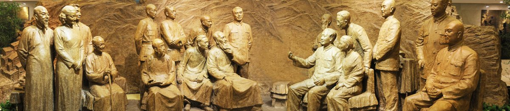

# 重庆红岩革命纪念馆（重庆红岩革命历史博物馆）

> 重庆市·渝中区 · 一级 · 其他行业国有博物馆

> 资料馆编号：e196ce8841164710938076bfd273f8ee

## 文物介绍（图文）

重庆红岩革命纪念馆（重庆红岩革命历史博物馆）位于重庆市·渝中区，为一级其他行业国有博物馆。馆藏与展陈以“革命纪念”为特色。

以下为馆方公开资料中可核实的代表性展品。每件文物单独成节，便于按名称检索和问答；完整文物卡见 `artifacts/` 目录。

### 群防群治百日攻坚

- **类别**：革命文物
- **馆藏**：重庆红岩革命纪念馆（重庆红岩革命历史博物馆）
- **简介**：红岩革命纪念馆景区： 023-63303457 歌乐山革命纪念馆景区： 023-65312300 来询及投诉受理邮箱： hongyanbowuguan@126.com 版权所有 © 2002-2026 重庆红岩革命历史文化中心（重庆红岩革命历史博物馆） 渝ICP备2023002937号 信息网络传播视听节目许可证号：2210490

### 关于歌乐山革命纪念馆部分景区暂停开放的通告

- **类别**：革命文物
- **馆藏**：重庆红岩革命纪念馆（重庆红岩革命历史博物馆）
- **简介**：红岩革命纪念馆景区： 023-63303457 歌乐山革命纪念馆景区： 023-65312300 来询及投诉受理邮箱： hongyanbowuguan@126.com 版权所有 © 2002-2026 重庆红岩革命历史文化中心（重庆红岩革命历史博物馆） 渝ICP备2023002937号 信息网络传播视听节目许可证号：2210490

### 关于中共中央南方局暨八路军驻重庆办事处旧址临时闭馆的通告

- **类别**：革命文物
- **馆藏**：重庆红岩革命纪念馆（重庆红岩革命历史博物馆）
- **简介**：红岩革命纪念馆景区： 023-63303457 歌乐山革命纪念馆景区： 023-65312300 来询及投诉受理邮箱： hongyanbowuguan@126.com 版权所有 © 2002-2026 重庆红岩革命历史文化中心（重庆红岩革命历史博物馆） 渝ICP备2023002937号 信息网络传播视听节目许可证号：2210490

### 红岩博物馆宣传片

- **类别**：革命文物
- **馆藏**：重庆红岩革命纪念馆（重庆红岩革命历史博物馆）
- **简介**：红岩革命纪念馆景区： 023-63303457 歌乐山革命纪念馆景区： 023-65312300 来询及投诉受理邮箱： hongyanbowuguan@126.com 版权所有 © 2002-2026 重庆红岩革命历史文化中心（重庆红岩革命历史博物馆） 渝ICP备2023002937号 信息网络传播视听节目许可证号：2210490

### 寻找红岩发声人

- **类别**：革命文物
- **馆藏**：重庆红岩革命纪念馆（重庆红岩革命历史博物馆）
- **简介**：红岩革命纪念馆景区： 023-63303457 歌乐山革命纪念馆景区： 023-65312300 来询及投诉受理邮箱： hongyanbowuguan@126.com 版权所有 © 2002-2026 重庆红岩革命历史文化中心（重庆红岩革命历史博物馆） 渝ICP备2023002937号 信息网络传播视听节目许可证号：2210490

## 历史背景资料

重庆红岩革命纪念馆（重庆红岩革命历史博物馆）的馆址位于重庆市·渝中区。本馆为一级其他行业国有博物馆。

馆方记载的建馆时间为 2007-01-19。

首次对外开放时间为 1958-05-01。

下辖红岩革命纪念馆（1958年建立）、歌乐山革命纪念馆（歌乐山烈士陵园）（1963年建立）、新华日报总馆旧址陈列馆（2023年设立）以及重庆红岩干部学院等。

2023年1月，在重庆红岩革命历史博物馆揭牌成立重庆市革命文物保护中心。

馆舍建筑面积约 2.6 万 平方米。

## 展厅分布与参观路线

### 展厅与陈列

下辖红岩革命纪念馆（1958年建立）、歌乐山革命纪念馆（歌乐山烈士陵园）（1963年建立）、新华日报总馆旧址陈列馆（2023年设立）以及重庆红岩干部学院等。

### 参观信息

| 项目 | 内容 |
|---|---|
| 馆址 | 重庆市渝中区红岩村52号 |
| 开放时间 | 9:00-17：00 |
| 是否免费 | 免费开放 |
| 预约方式 | 无需预约。如确需联系，渝中片区咨询电话：023-63303457，沙坪坝片区咨询电话：023-65312300。 |
| 联系电话 | 023-63300192,023-63303075 |
| 官方网站 | https://www.hongyanmuseum.cn/ |
| 建筑面积 | 2.6 万 平方米 |
| 展厅面积 | 1.1 万 平方米 |
| 年参观量 | 252.6 万 人次 |

### 建议参观路线

入口/序厅 → 常设展厅 → 专题展厅 → 临时展览 → 文创商店/出口。

以上为一般参观顺序，实际开放展厅与动线以馆方当日公告为准。

## 书画知识

### 书画收藏定位

重庆红岩革命纪念馆（重庆红岩革命历史博物馆）公开资料未将书画列为核心收藏，具体展陈以馆方公告与展厅展签为准。

### 地域书画脉络

重庆的书画与巴渝文化、大足石刻的线刻传统相关；抗战时期大量美术家汇聚重庆，四川美术学院又形成了当代绘画的重要现场。

### 观赏要点

革命题材书画要结合创作年代与事件背景；版画、宣传画、油画、国画各有材料语言，不能一律套用传统水墨标准。

在重庆红岩革命纪念馆（重庆红岩革命历史博物馆）参观时，可把展签上的名称、年代、出土地和馆藏信息与展件对照阅读；若遇临时展览，以其主题说明为准。

## 资料来源

- 国家文物局全国博物馆年度报告（2025 年）
- [重庆红岩革命纪念馆（重庆红岩革命历史博物馆）官网](https://www.hongyanmuseum.cn/)
